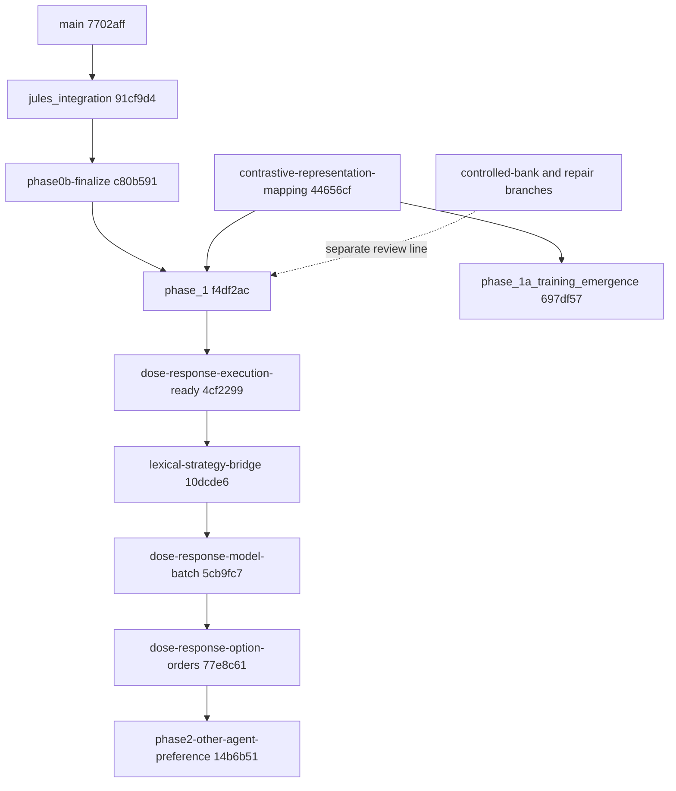

# Branch integration plan

**Audit date:** 2026-11-26  
**Default branch at audit:** `main` — `7702affbf4a159ff916047d85f7c7139b5a03851`  
**Working research branch at audit:** `codex/phase2-other-agent-preference` — `14b6b51dc1c879a82f81d9db8ebc5c606986ca50`

## Recommendation

Treat `main` as the public canonical branch and integrate the work in small, reviewable stages. Do not merge the latest research branch wholesale. The refs share history: several later branches are successive extensions of one long line, while training-emergence and controlled-bank work diverge separately. The latest Phase 2 head is 158 commits and 5,370 changed paths ahead of `main`, including 470 result paths, 37 `.local` paths, and 2,868 tracked paths with binary-like extensions (`.zip`, `.npz`, `.safetensors`, or `.bin`). Those totals describe the branch diff, not a recommendation to publish every file.

Keep the source branches and their commits intact while integrating. For each accepted unit, record its source branch and commit range, the files selected, the provenance manifests and hashes retained, and the review or validation performed. This preserves experimental history without making every accumulated branch diff part of the public branch.

## Current branch and pull-request picture

The local remote-tracking refs contain **23 branches including `main`**. The current local `main` matches `origin/main`; no branch merge or deletion has been performed for this plan.

GitHub currently lists three open pull requests:

| PR | Source → target | State and integration implication |
| --- | --- | --- |
| [#2 Jules integration branch](https://github.com/Founder-ArcaFutura/llm_cooperation/pull/2) | `jules_integration` → `main` | Open and reported mergeable. Its 18 commits include the Phase 0 expansion/replication history and five-model result additions. Review its exact file list and run provenance before merging. |
| [#5 Phase 0B utility-matched assay](https://github.com/Founder-ArcaFutura/llm_cooperation/pull/5) | `phase-0b-utility-matched-assay-37253646738356728` → `jules_integration` | Open and reported mergeable, but stacked on PR #2. Its 3-commit head is an ancestor of `phase0b-finalize`, which adds 7 later commits. Do not integrate both heads as separate copies of the same Phase 0B work. |
| [#14 Codex/lexical strategy bridge](https://github.com/Founder-ArcaFutura/llm_cooperation/pull/14) | `codex/lexical-strategy-bridge` → `main` | Open and reported mergeable. It is 105 commits and 4,458 paths ahead of `main`; its scope has accumulated later shared work and binary artifacts. Technical mergeability is not a review of that full scope. |

Mergeability is a GitHub status, not scientific, provenance, or content approval. Recheck PR state and branch tips before acting; these observations are a dated snapshot.

## Observed ancestry

`phase-0b-utility-matched-assay` is three commits after `jules_integration`; `phase0b-finalize` is ten commits after `jules_integration` and contains that earlier Phase 0B head. `phase0b-finalize-corrections` is an ancestor within this sequence, not a newer alternative. `phase_1` descends from `phase0b-finalize` by 62 commits. The later research chain is also stacked: `phase_1` → dose-response execution-ready (+9 commits) → lexical strategy bridge (+6) → dose-response model batch (+6) → option-order replications (+23) → Phase 2 other-agent preference (+24).

The `phase_1a_training_emergence` line diverges from the primary `phase_1` line and must be integrated separately. The controlled-strategy-bank, repair, and offline-audit refs form another related cluster that needs a file- and commit-level review before selecting a single accepted version.

## Proposed integration order

### 1. Establish a clean public baseline

Use a fresh worktree at the exact `origin/main` SHA above for integration. Keep the current research checkout available as an evidence source. Put each focused change in its own PR targeting `main`; avoid introducing a new long-lived integration branch that would become another branch to reconcile.

Before the first merge, inventory files in each PR and identify raw run records, derived analyses, caches, activation tensors, model weights, archives, and generated bundles separately. Preserve source commits and immutable hashes. Do not silently discard an artifact because it is large, and do not add caches or checkpoints just because they appear in a branch diff.

### 2. Resolve the Phase 0 foundation

Review PR #2 first. It is the base dependency for PR #5, and its source already contains the earlier Phase 0 expansion/replication branch history. Review the result files and manifests as evidence; inspect only the exact PR file list rather than inferring scope from the title. After review and the repository's normal validation, merge the accepted Phase 0 foundation once.

### 3. Integrate the final Phase 0B state once

After the Phase 0 foundation lands, review `phase0b-finalize` as the candidate final state. It contains PR #5's three commits plus seven follow-up commits and changes 34 paths relative to `jules_integration`, including the utility-matched bank, protocol, run records, audit materials, analysis code, and tests. Compare those later corrections with the open PR #5. If the final state is accepted, open or retarget one PR for that state; close PR #5 as superseded only after the replacement PR is visible and its selected diff is confirmed. Do not merge both versions and then repair duplicates.

The Phase 0B review matrix and machine-generated review outputs must retain their distinct provenance. They are not equivalent to completed independent human scientific review.

### 4. Publish the primary findings as a curated evidence bundle

The current manuscript and its source audit live on a later branch, not on `main`. Add them through a focused evidence PR after checking every linked file and its provenance. The bundle should include the canonical manuscript, readiness report, cohort provenance manifest, statistical readout, post-hoc methods/results, reviewer brief, and only figures that are clearly labeled with their model, bank, and run scope. Confirm that links work from the proposed `main` tree before updating the README.

Keep the README and research index in this same public-docs PR or a following documentation-only PR, so the new landing page does not point readers to files available only on a feature branch. Do not publish superseded drafts as co-equal results.

### 5. Integrate later behavioral work as separate research PRs

The Phase 1, lexical, dose-response, option-order, choice-set, factorial, and Phase 2 results accumulated along the `phase_1` → `codex/lexical-strategy-bridge` → `codex/dose-response-execution-ready` → `codex/dose-response-model-batch` → `codex/dose-response-option-orders` → `codex/phase2-other-agent-preference` chain. Review them one scientific question at a time. Each PR should state its estimand, bank and split, run IDs, analysis version, controls, status (exploratory or otherwise), and limitations. Do not merge this chain as a single 158-commit package.

In particular, the Phase 1 bank's recorded review/execution chronology conflict must be resolved in the public text before presenting it as prospective replication. Option-order, dose-response, and choice-set interventions should remain distinct from the canonical utility-matched cohort.

### 6. Review parallel lines independently

- **Training emergence:** Review `phase_1a_training_emergence` separately from the main Phase 1 chain. Select the checkpoint, manifest, report, and minimum code needed to reproduce the claim; preserve run history. Keep results exploratory unless a validated design supports a stronger claim.
- **Mechanistic/contrastive mapping:** Review `feat/contrastive-representation-mapping-13738998912391132934` separately. Include negative controls, position/format diagnostics, and the relevant source artifacts. Do not present exploratory activation associations as a cooperation circuit.
- **Controlled banks and repair:** Compare `controlled-strategy-banks-v1-13918473886041179938`, `jules-offline-audit-controlled-banks-8066843917409867526`, `feat/repair-controlled-strategy-banks-phase1-1512837076784829532`, and `codex/controlled-repair-engine` by changed files, commit ancestry, and acceptance criteria. Select the accepted repair lineage once; keep rejected or unadjudicated candidates quarantined with their provenance.
- **Prospective Phase 1 implementation:** Review `feat/phase1-prospective-replication-5270364427869683014` as a protocol/freeze-control contribution, distinct from executed Phase 1 results and from the unresolved status conflict.

### 7. Retire branches only after reconciliation

After a focused PR lands, mark the corresponding source ref as integrated in a branch ledger and keep it until the retained history and artifacts are verified. Branch deletion is a separate cleanup decision: first ensure the commits are reachable from `main` or a durable archive tag and that any excluded research artifact has a documented location and checksum. No branch is classified for deletion in this plan.

## Required review record for each PR

Before merging an integration PR, record:

1. Exact base SHA, source branch SHA, and commit range.
2. A scoped changed-file list, with large or binary artifacts explicitly categorized.
3. Evidence provenance: model revision, bank/prompt hash, run ID, analysis hash, and artifact checksum where applicable.
4. What is validated, what is exploratory, and which human reviews remain pending.
5. Relevant automated checks and their results, plus any known exclusions or failures.
6. Confirmation that README/index links resolve from the resulting `main` tree.

The user subsequently authorized execution of this plan. Preserve every source branch and existing artifact; do not rewrite or force-push history. Refresh refs and verify remote state after every merge. The dated inventory above remains the pre-execution snapshot.

## Execution record — 2026-11-26

### Initial PR #2 review gate (superseded by the revised provenance policy and merge below)

- Refreshed all remotes without pruning. `origin/main` remained `7702affbf4a159ff916047d85f7c7139b5a03851`; PR #2 head was `91cf9d4d3f958a671c01285ac2b8833c0878e712`.
- Preserved the pre-existing dirty root checkout. Review and validation ran in a dedicated detached worktree at the PR head.
- Confirmed that the two previously reported P1 implementation findings are fixed in the current head: model/checkpoint summaries are deduplicated and the advancement screen requires distinct families; mock routing goes to a CPU-only Modal function. Targeted tests cover both.
- Targeted validation passed: 26 tests across `test_regressions.py`, `test_expanded_study.py`, and `test_pipeline.py`; expanded-bank and calibration-bank audits; and a local CPU mock run over 480 expanded-bank presentations. No GPU or paid inference was launched.
- Source-bank provenance: the expanded bank's Git blob SHA-256 matches the protocol's `ba6c93c9...` after line-ending normalization. Windows checkout bytes use CRLF and therefore have a different raw-file SHA-256; the recorded run hash reflects those CRLF bytes. Keep this platform-sensitive hash behavior visible in any reproducibility instructions.
- **Merge blocked pending provenance adjudication.** All 14 PR #2 result headers have `model_revision: null`, `tokenizer_revision: null`, and `git_commit: null`; model configs pin several base models to mutable `main` revisions. The expanded-study protocol requires immutable checkpoint/tokenizer revisions and execution provenance. The exact historical model snapshots are not identified by the committed run records. Do not present those model outputs as exactly regenerable until an existing source record recovers the revisions or the results are expressly separated from any reproducibility claim. No replacement inference is authorized by this integration plan.
- The two earlier inline review threads now have evidence-backed replies and are resolved. PR #2's description records the remaining provenance gate; the PR itself remains open and unmerged.

### Initial dependent milestones (superseded)

- PR #2 merge: **not performed**; blocked by the empirical-run provenance gap above.
- Focused `phase0b-finalize` PR and PR #5 supersession: **not started**; dependent on a validated Phase 0 baseline.
- Canonical evidence PR: **not started**; dependent on a validated baseline and complete transitive provenance audit.
- PR #14 / accumulated Phase 2: **not merged**. Continue to decompose into scoped research PRs after the canonical baseline is established.

### Existing public-branch exposure

- Confirmed reachable from the public remote branch `codex/phase2-other-agent-preference`: `INTERNAL_UNBLINDING_KEY.json` (152 packet records), `review_RESTRICTED_key.json` (352 records), blinded review packets, `.local` cache files, activation/embedding arrays, and archive bundles. This compromises the intended separation for any review packet whose mapping is present; do not include these keys or packets in the canonical evidence PR. Existing public history retains the exposure.
- A high-entropy Hugging Face token-shaped value is embedded in `docs/runpod_lambda_setup.md:64` on that public branch. Treat it as compromised; never reproduce it in PR text or logs. The credential owner must revoke/rotate it. A later public-doc correction can replace the value with a placeholder, but that cannot remove the already-public value from history without a separate history-rewrite decision, which this plan forbids.
- A bounded scan of the Phase 2 tip found no matches for common OpenAI, AWS, GitHub, PEM private-key, or Slack-token patterns; the Hugging Face token-shaped value is the confirmed exception. Filename-based checks are not a complete secret audit.
- The Phase 2 diff from `main` contains 5,370 paths, 37 `.local` cache paths, and 2,901 files with array/archive/model-like extensions. Those counts include incidental run outputs and development bundles; they are not a reproducibility inclusion list. Triage only artifacts required by a scoped, validated research claim.

### Remote state at initial pause (superseded)

- No PR has been merged or created by this execution. PR #2 remains open; `main` remains `7702affbf4a159ff916047d85f7c7139b5a03851`. All source branches remain intact.
- PR #2 is not safe to merge until the historical run provenance gap is resolved or its evidence scope is explicitly separated in a reviewable integration proposal. Its code tests and item-bank audits pass; this does not make the empirical run records fully reproducible.
- Do not proceed with dependent Phase 0B or canonical evidence merges while their baseline assumptions remain unsettled. Keep the public token and blinding exposure out of any new PR, and address the exposed credential before publishing material from the Phase 2 branch.

## Execution update — 2026-11-26 (revised provenance policy)

The previous global stop on incomplete historical execution revisions is withdrawn. A missing model/tokenizer/inference-code revision qualifies the affected historical outputs; it does not prevent validated implementation code or properly disclosed observations from integration.

### Completed milestones

- PR #2 merged with ancestry-preserving merge commit `ff6b650fa45c8f475bf0c4dc81f7d05921d5b7c0`. Its Phase 0 records remain historical observations with incomplete execution provenance; saved choices may be analytically reanalyzed, but exact model-output regeneration is not established. The separate pilot and expanded cohorts are not pooled as a common-model comparison.
- Phase 0B focused integration PR #18 merged with merge commit `d48739fab9be627b39d4a6752040081e2c1e94c4`. It includes PR #5's head once by ancestry, all seven later commits on `phase0b-finalize`, and explicit cohort qualifications. PR #5 was closed as superseded after verifying the replacement merge. Original branches remain intact.
- Phase 0B: 8 exploratory-only runs and 4 full-bank runs; the latter exposed the nominal confirmatory split and are not prospective confirmation. All 12 run headers lack verified model, tokenizer, and inference-code revisions. The separate post-hoc AI audit is not human or pre-inference approval. The 3.14-word option-length spread exceeds the 3.1 target and remains flagged for human review. Raw records are unchanged.
- Validation: PR #2's 26 tests, bank audits, and CPU mock passed; Phase 0B's 33 tests, bank audit, 240-presentation CPU mock, offline audit report reconstruction, and saved-choice reanalysis passed. No paid inference or GPU execution was started.

### Security and methodological incidents

- A Hugging Face token-shaped credential was removed from current public setup documentation on branch `codex/phase2-other-agent-preference` in commit `58da0bd8fbb4ea33e166ec32ab73b0409ae7a0a3`; the local stale copy is also being replaced with a placeholder. Public Git history may retain the value. The credential owner must revoke/rotate it; no token value is reproduced here. A bounded pattern scan is not a complete secret audit.
- Public branch history contains three mapping-key families: the 152-record manuscript-readiness packet key (including the 76-priority subset), a 352-record factorial review key, and a 6-mapping construct-QA key for 3 packets. Associated packet templates have no recorded completed human responses. Treat all mapped packets as compromised for blinding and do not count them as independent human-review evidence. Preserve archival history. For future review, regenerate packet IDs and order from a frozen bank, keep the mapping key with an independent custodian off GitHub, recruit reviewers not exposed to prior keys, and capture dated responses before unblinding.

### Current integration state

- Remote `main` was verified at `d48739fab9be627b39d4a6752040081e2c1e94c4` after PR #18; see final state below.
- PR #5 closed as superseded by PR #18; its branch remains. PR #14 remains open and unmerged (4,458 files, 5,575,507 additions at the last verified view). The accumulated Phase 2 branch is not to be merged wholesale.
- Canonical evidence PR #19: merged at `158efbd2740d5981a8e3bd38151193ef1c460a53`. Evidence eligibility and provenance were assessed cohort by cohort; incomplete historical execution fields qualified the affected cohorts without blocking unrelated implementation or evidence.
- Remaining Phase 1, lexical, dose-response, option-order, choice-set, factorial, Phase 2 preferences, checkpoint emergence, and mechanistic work remain separate scoped integration candidates with their own dependencies and evidence status.

## Final integration closeout — 2026-11-26

### Verified remote milestones

| Pull request | Result | Verified main merge SHA |
| --- | --- | --- |
| #2 Phase 0 foundation | Merged with ancestry-preserving merge commit | `ff6b650fa45c8f475bf0c4dc81f7d05921d5b7c0` |
| #18 focused Phase 0B integration | Merged; PR #5's head included once by ancestry | `d48739fab9be627b39d4a6752040081e2c1e94c4` |
| #5 Phase 0B original | Closed as superseded after #18 merged; source branch preserved | — |
| #19 canonical evidence and public research index | Merged with qualified historical provenance and supporting source rows | `158efbd2740d5981a8e3bd38151193ef1c460a53` |
| #14 accumulated lexical/Phase 2 branch | Still open and unmerged; 4,458 files and 5,575,507 additions at last verification | — |

After PR #19, `origin/main` was fetched and verified at `158efbd2740d5981a8e3bd38151193ef1c460a53`. Research branches were preserved. No branch was deleted, no history was rewritten, and no paid inference or GPU experiment was launched.

### Canonical evidence and checks

The default branch now contains the research overview and phase index; the manuscript, readiness report, author review brief, provenance qualification, machine-readable manifests/readouts, relevant illustrative figures, model/scenario/paraphrase sources, all 17 paired-wording run records (14 canonical plus three duplicates), the six choice-set runs used by post-hoc analysis, and the scripts/tests needed for offline reproduction. It does not contain the exposed review keys, caches, model weights, arrays, or ZIP bundle.

All 14 paired-wording runs have recorded resolved model revisions, and their row/bank hashes verified after line-ending normalization. Tokenizer revisions are absent in all 14. Retained Git history matched 42 of 56 recorded inference-source file/run digests; the remaining 14 point to one unavailable historical assay-source digest. The included analysis reproduced the saved descriptive and post-hoc numeric outputs exactly on this Windows environment. This supports analytical reproduction from saved choices, not exact regeneration of the historical model outputs. Phase 1 remains exploratory because its held-out metadata conflicts with the existence of runs and pre-inference review was not established. Human semantic review remains incomplete.

Final canonical PR checks: 14/14 run audit across 17 dirs; 2,000-resample descriptive readout with seed 42 matched; 22 four-option and six three-option Monte Carlo results at 50,000 iterations/seed 20261111 matched; 8 targeted tests passed; the Phase 0B PR's 33 tests, bank audit, and 240-row CPU mock passed; PR #2's 26 tests, bank audits, and 480-row CPU mock passed. Relative README/index/manuscript/readiness links and pinned external commit links resolved. The targeted PR diff scan found no token/private-key patterns.

### Open incidents and next research streams

- The Hugging Face token-shaped value was removed from the current setup document, but prior public Git history may retain it. The credential owner still must revoke/rotate it. No value is reproduced in the repository closeout.
- Three public packet-key families compromise the 152 manuscript-readiness packets (including the 76-priority subset), 352 factorial packets, and 3 construct-QA packets. The inspected response templates contain no completed independent human ratings. Do not reuse these IDs or call them blind review. Generate new randomized IDs/order, keep the new mapping key with an independent custodian off GitHub, and recruit reviewers not exposed to the old packets.
- Continue remaining work as separate PRs: Phase 1 chronology/protocol reconciliation and prospective replication; option-order and dose-response studies; lexical geometry; choice-set extensions beyond the six selected exploratory runs; factorial assays; checkpoint-emergence trajectories; mechanistic/contrastive probes; and the other-agent preference stream. Each needs its own bank/run/provenance review. PR #14 and the accumulated Phase 2 branch remain decomposed, not wholesale merge candidates.
