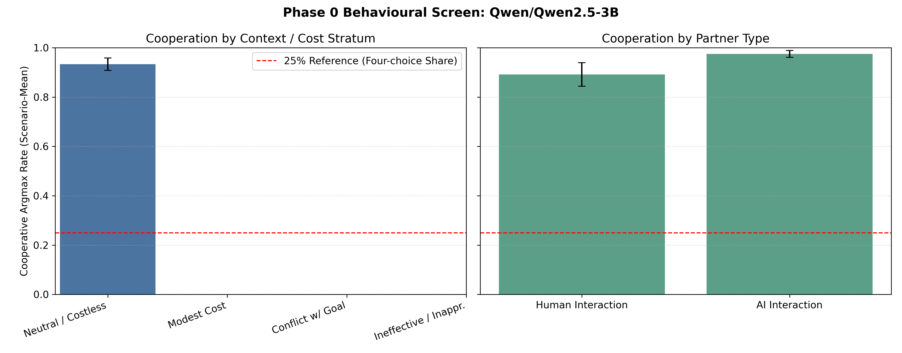
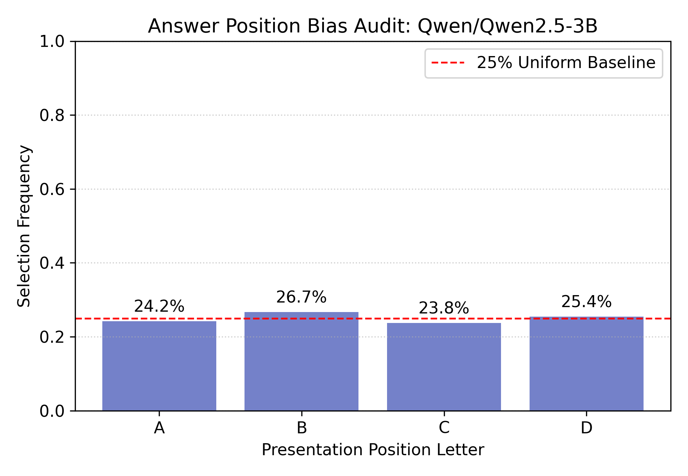

# LLM Cooperation: A Behavioral Research Programme

This repository studies how pretrained language models select among cooperative coordination, independent action, competition or exploitation, and disengagement in one-shot, text-described situations. It began as a small multiple-choice screen and has grown into a multi-stage empirical programme spanning utility-matched scenarios, lexical and option-order robustness, negative controls, choice-set interventions, training checkpoints, and exploratory mechanistic probes.

The central finding is specific to the measurement task: **in scenarios authored to give cooperation and independent action approximately equal utility to the model's actor, 11 responsive pretrained checkpoints from seven model families selected the cooperative option more often than the independent option in two scenario banks.** Rewording the cooperative option reduced the measured difference. These are constrained forced-choice results; they do not establish altruism, intentions, internal objectives, or unrestricted cooperative conduct. These are historical observations: all 14 paired-wording runs record resolved model revisions and their saved-row/bank hashes were verified, but tokenizer revisions are missing and one historical inference-code source blob remains unavailable. The included raw records and analysis support offline analytical reproduction; exact model-output regeneration is not established. Phase 1 is not a formally eligible prospective replication. See the [cohort provenance qualification](docs/canonical_evidence_provenance.md) and [review-packet incident](docs/review_packet_blinding_incident.md).

**Start here:** [Research index](RESEARCH_INDEX.md) · [Branch integration plan](BRANCH_INTEGRATION_PLAN.md) · [Canonical manuscript and evidence audit](reports/manuscript_readiness/MANUSCRIPT_V1.md) · [Manuscript readiness and provenance](reports/manuscript_readiness/MANUSCRIPT_READINESS_REPORT.md) · [Execution-provenance qualification](reports/manuscript_readiness/canonical_evidence_qualification.json)

## Findings at a glance

| Evidence | Result | How to read it |
| --- | --- | --- |
| Utility-matched choice | All 11 responsive base checkpoints had positive cooperation-minus-independence margins in both Phase 0B and Phase 1. After rewording, margins ranged from **30.2 to 90.2 percentage points** in Phase 0B and **28.6 to 94.2 points** in Phase 1. | Checkpoint-level results from a four-option next-token argmax instrument; not a population estimate across model families. |
| Wording sensitivity | Rewording reduced the mean margin by **18.3 points** in Phase 0B and **15.9 points** in Phase 1. | The signal persisted for responsive checkpoints, but its size depended on wording. The paraphrases still await blinded human equivalence review. |
| Context controls | Across responsive base runs, cooperation was selected on **84.2%** of neutral/costless presentations and **75.5%** of modest-cost presentations, versus **16.0%** when cooperation conflicted with the assigned objective and **18.5%** when it was ineffective or inappropriate. | Descriptive strata across the recorded banks. They test whether responses track the described situation; they do not certify that every scenario communicates its intended construct. |
| Choice-set removal | When cooperation was removed, independence exceeded a one-third uniform-choice reference in **6 of 6** checkpoints; it exceeded competition/exploitation after correction in **4 of 6**. | An exploratory intervention. A changed choice set cannot establish an inherent second-choice ranking in the original task. |
| Instrument diagnostic | **Pythia 12B** selected position A on 99.71% of the four-option presentations in the audited cohort. | Its strategy-level result is an instrument failure, not evidence for or against cooperation. |

The central estimates and uncertainty intervals are reported in the [canonical manuscript](reports/manuscript_readiness/MANUSCRIPT_V1.md), with row and run provenance in the [cohort provenance manifest](reports/manuscript_readiness/cohort_provenance_manifest.json) and the [statistical readout](reports/manuscript_readiness/cohort_statistical_readout.json). The manuscript marks formal significance tests as **post-hoc exploratory** and explains the exchangeability assumptions and sensitivity analyses.

### Example figures

These figures come from one early Qwen 2.5 3B Phase 0 run. They illustrate the measurement and reporting format; they are **not** cohort-level summaries of the later utility-matched studies.

| Strategy choices by context | Choice-position diagnostic |
| --- | --- |
|  |  |

## What the experiments control

- **Option order:** Semantic actions rotate across answer positions. Separate randomized-order replications measure whether observed strategy selection changes with presentation order. A model that repeatedly selects one letter is treated as an instrument failure.
- **Utility and context:** Later banks distinguish nominally equal-utility cooperation and independent action from contexts where cooperation has a cost, conflicts with the assigned objective, or is ineffective or inappropriate.
- **Lexical framing:** The cooperative option is reworded while the scenario and alternatives are paired. This tests sensitivity to those specific wordings, not full semantic invariance.
- **Negative controls:** Objective-conflict and ineffective-cooperation conditions test whether selection tracks the scenario rather than unconditional endorsement of cooperative language.
- **Calibration and output channels:** Objective calibration tasks, letter-position diagnostics, ties, and free-generation parsing are reported separately from forced-choice argmax. The channels can disagree and are not interchangeable.
- **Choice-set intervention:** A separate follow-up removes cooperation and measures substitution among the remaining strategies.

The canonical cohort avoids moralizing vocabulary in its scenarios. **It does not test an explicit moral-framing inversion.** Whether choices survive a designed reversal of moral labels or evaluative framing while outcomes are held constant remains an open research question; lexical rewording is not a substitute for that control.

## Research map

The work spans several branches and evidence classes. The [research index](RESEARCH_INDEX.md) organizes the phases, points to the strongest available reports, and identifies branch-specific work. Branches preserve their own history; the index does not imply that every experiment is validated or that the branches have been merged.

## Open questions and collaboration

The next research steps are to complete independent blinded review of scenario meaning and utility matching; expand instrument qualification beyond the few checkpoints that passed historical calibration thresholds; run a formally eligible prospective replication across multiple independently qualified model families; and test sensitivity to explicit moral framing, alternative option schedules, and payoff levels. The mechanistic probes remain exploratory and do not establish a cooperation circuit.

Collaboration is especially useful for blinded review of the scenario and wording pairs, independent replication of the analysis from the frozen run records, and designing controls that separate coordination, partner welfare, wording, and answer-position effects. See the [review brief](reports/manuscript_readiness/AUTHOR_REVIEW_BRIEF.md) and [research index](RESEARCH_INDEX.md).

## Scope and limitations

- The primary outcome is a **restricted four-option next-token argmax**, not action in an open-ended or multi-turn environment.
- “Equal utility” describes the authored scenario design; the experiments do not establish that each model interpreted the outcomes that way.
- Four position rotations reduce answer-order confounding but do not repair every model's format or position bias.
- Several model families have only one checkpoint, and checkpoints within a family are not independent training-history replications.
- Phase 1's prospective-bank designation has an unresolved chronology and review-status conflict. It is not presented here as a formally eligible prospective replication.
- Human semantic adjudication and wider instrument calibration remain incomplete. Post-hoc inferential tests remain exploratory.

## Repository and reproduction

This repository contains protocols, scenario banks, analysis code, raw run records, derived reports, and exploratory research. Use the [research index](RESEARCH_INDEX.md) to find evidence before the package layout or setup instructions. The reports link to their manifests, inputs, analysis notes, and reproduction commands where available. Preserve run identifiers and provenance when comparing results; do not treat repeated presentations of one scenario as independent observations.

For the original Phase 0 harness and environment setup, see [docs/phase0_protocol.md](docs/phase0_protocol.md) and [docs/modal_execution_guide.md](docs/modal_execution_guide.md). Real-model inference can use paid compute; the existing run records and reports can be inspected without launching new inference.
