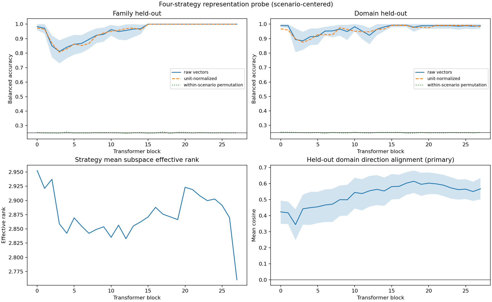
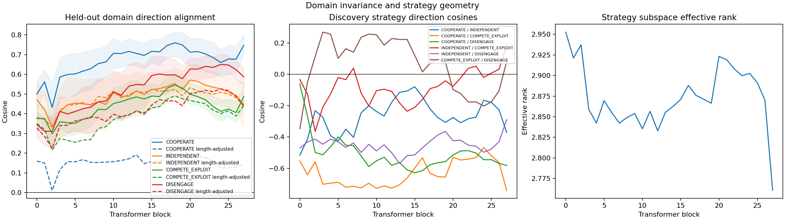

# Four-strategy linear-probe analysis

- Model: `Qwen/Qwen2.5-1.5B` revision `8faed761d45a263340a0528343f099c05c9a4323`
- Source run: `G:\llm_cooperation\mechanistic_artifacts\safe_download_full\contrastive-mapping-9ba6be347e1643c6ad01ad72b3a3e1b9`
- Scenarios/prompts: 124 / 496
- Tensor: [28, 1536] per prompt

Tests linear distinguishability of the four presented action descriptions in residual-stream activations. Does not establish preference, action selection, or distinct causal decision mechanisms. First detectable layer is not an origin claim.

Scenario-centered residual vectors are evaluated with discovery-only regularization selection and grouped held-out evaluation.

See [EMPIRICAL_INTERPRETATION.md](EMPIRICAL_INTERPRETATION.md) for a run-specific scientific interpretation.

## Empirical summary

Family-held-out balanced accuracy spans 0.812–1.000; strict domain-held-out balanced accuracy spans 0.885–0.993 (macro-F1 0.855–0.993). Unit-normalized domain accuracy spans 0.875–0.992; length-adjusted accuracy spans 0.548–0.895.

Raw held-out-domain direction-alignment pointwise 95% cluster intervals are positive for all four strategies at every layer: True. The length-adjusted exploratory candidate layers are 17, 18, 19, 21, 22, 23, requiring all four alignment and projection-margin intervals to exclude zero and adjusted four-class balanced accuracy ≥ 0.85. These pointwise scans are not multiplicity-corrected and do not localize representational origins.

| Strategy | Raw domain alignment mean range | Length-adjusted alignment mean range |
|---|---:|---:|
| COOPERATE | 0.433–0.760 | 0.012–0.226 |
| INDEPENDENT | 0.335–0.571 | 0.332–0.532 |
| COMPETE_EXPLOIT | 0.298–0.546 | 0.215–0.491 |
| DISENGAGE | 0.311–0.650 | 0.225–0.526 |

## Template/triad-family held-out

| Layer | Balanced accuracy (cluster 95% CI) | Macro-F1 (cluster 95% CI) | Direction-normalized BA | Permutation mean | C |
|---:|---:|---:|---:|---:|---:|
| 0 | 0.983 [0.958, 1.000] | 0.980 [0.948, 1.000] | 0.973 | 0.253 | 10 |
| 1 | 0.972 [0.935, 1.000] | 0.963 [0.926, 1.000] | 0.966 | 0.250 | 10 |
| 2 | 0.850 [0.772, 0.923] | 0.827 [0.747, 0.900] | 0.867 | 0.249 | 10 |
| 3 | 0.812 [0.730, 0.889] | 0.773 [0.677, 0.861] | 0.807 | 0.248 | 10 |
| 4 | 0.841 [0.764, 0.909] | 0.805 [0.719, 0.887] | 0.830 | 0.256 | 10 |
| 5 | 0.861 [0.790, 0.926] | 0.828 [0.747, 0.911] | 0.864 | 0.249 | 1 |
| 6 | 0.867 [0.802, 0.924] | 0.833 [0.744, 0.909] | 0.852 | 0.250 | 10 |
| 7 | 0.895 [0.830, 0.951] | 0.866 [0.791, 0.935] | 0.867 | 0.250 | 10 |
| 8 | 0.923 [0.869, 0.971] | 0.904 [0.830, 0.960] | 0.920 | 0.252 | 10 |
| 9 | 0.931 [0.880, 0.977] | 0.909 [0.840, 0.965] | 0.939 | 0.253 | 10 |
| 10 | 0.963 [0.921, 0.995] | 0.953 [0.901, 0.995] | 0.951 | 0.251 | 10 |
| 11 | 0.949 [0.894, 0.986] | 0.939 [0.881, 0.983] | 0.958 | 0.251 | 1 |
| 12 | 0.957 [0.889, 0.998] | 0.953 [0.887, 0.998] | 0.970 | 0.246 | 10 |
| 13 | 0.966 [0.910, 1.000] | 0.962 [0.901, 1.000] | 0.973 | 0.251 | 10 |
| 14 | 0.969 [0.931, 0.997] | 0.963 [0.916, 0.995] | 0.962 | 0.253 | 1 |
| 15 | 1.000 [1.000, 1.000] | 1.000 [1.000, 1.000] | 1.000 | 0.247 | 1 |
| 16 | 1.000 [1.000, 1.000] | 1.000 [1.000, 1.000] | 1.000 | 0.250 | 1 |
| 17 | 1.000 [1.000, 1.000] | 1.000 [1.000, 1.000] | 1.000 | 0.257 | 10 |
| 18 | 1.000 [1.000, 1.000] | 1.000 [1.000, 1.000] | 1.000 | 0.246 | 1 |
| 19 | 1.000 [1.000, 1.000] | 1.000 [1.000, 1.000] | 1.000 | 0.254 | 10 |
| 20 | 1.000 [1.000, 1.000] | 1.000 [1.000, 1.000] | 1.000 | 0.254 | 0.01 |
| 21 | 1.000 [1.000, 1.000] | 1.000 [1.000, 1.000] | 1.000 | 0.249 | 0.01 |
| 22 | 1.000 [1.000, 1.000] | 1.000 [1.000, 1.000] | 1.000 | 0.253 | 0.1 |
| 23 | 1.000 [1.000, 1.000] | 1.000 [1.000, 1.000] | 1.000 | 0.251 | 0.01 |
| 24 | 1.000 [1.000, 1.000] | 1.000 [1.000, 1.000] | 1.000 | 0.250 | 0.01 |
| 25 | 1.000 [1.000, 1.000] | 1.000 [1.000, 1.000] | 1.000 | 0.251 | 0.01 |
| 26 | 1.000 [1.000, 1.000] | 1.000 [1.000, 1.000] | 1.000 | 0.250 | 0.1 |
| 27 | 1.000 [1.000, 1.000] | 1.000 [1.000, 1.000] | 1.000 | 0.251 | 0.1 |

## Strict domain-held-out

Domain-level directional agreement with the discovery aggregate is the primary outcome. Each held-out domain is summarized separately after within-scenario centering; cluster intervals resample held-out domains. Length-adjusted columns use discovery-only ridge residualization of centered word and character counts.

| Layer | Strategy | Held-out direction cosine (95% CI) | Length-adjusted cosine (95% CI) | Projection margin (95% CI) | Length-adjusted margin (95% CI) | Discovery domain-pair cosine (95% cluster CI) |
|---:|---|---:|---:|---:|---:|---:|
| 0 | COOPERATE | 0.500 [0.429, 0.563] | 0.160 [0.083, 0.230] | 0.348 [0.292, 0.404] | 0.098 [0.056, 0.140] | 0.332 [0.267, 0.541] |
| 0 | INDEPENDENT | 0.472 [0.383, 0.554] | 0.383 [0.305, 0.454] | 0.341 [0.285, 0.406] | 0.261 [0.218, 0.302] | 0.244 [0.238, 0.405] |
| 0 | COMPETE_EXPLOIT | 0.376 [0.310, 0.444] | 0.351 [0.279, 0.420] | 0.285 [0.233, 0.342] | 0.263 [0.200, 0.323] | 0.161 [0.172, 0.330] |
| 0 | DISENGAGE | 0.346 [0.274, 0.410] | 0.329 [0.255, 0.394] | 0.248 [0.208, 0.281] | 0.232 [0.193, 0.269] | 0.166 [0.169, 0.333] |
| 1 | COOPERATE | 0.563 [0.497, 0.625] | 0.150 [0.070, 0.226] | 0.585 [0.500, 0.670] | 0.126 [0.063, 0.179] | 0.409 [0.346, 0.598] |
| 1 | INDEPENDENT | 0.420 [0.337, 0.511] | 0.371 [0.282, 0.457] | 0.435 [0.351, 0.521] | 0.371 [0.301, 0.442] | 0.278 [0.269, 0.432] |
| 1 | COMPETE_EXPLOIT | 0.376 [0.316, 0.436] | 0.321 [0.263, 0.375] | 0.440 [0.349, 0.535] | 0.371 [0.277, 0.463] | 0.159 [0.169, 0.335] |
| 1 | DISENGAGE | 0.311 [0.242, 0.379] | 0.285 [0.222, 0.348] | 0.309 [0.261, 0.358] | 0.282 [0.233, 0.335] | 0.160 [0.168, 0.320] |
| 2 | COOPERATE | 0.433 [0.314, 0.556] | 0.012 [-0.100, 0.117] | 1.160 [0.845, 1.507] | -0.037 [-0.348, 0.232] | 0.275 [0.223, 0.474] |
| 2 | INDEPENDENT | 0.335 [0.228, 0.440] | 0.332 [0.224, 0.442] | 0.874 [0.571, 1.152] | 0.872 [0.580, 1.186] | 0.173 [0.164, 0.375] |
| 2 | COMPETE_EXPLOIT | 0.298 [0.228, 0.368] | 0.215 [0.139, 0.295] | 0.819 [0.556, 1.118] | 0.609 [0.318, 0.890] | 0.122 [0.114, 0.300] |
| 2 | DISENGAGE | 0.311 [0.220, 0.394] | 0.225 [0.130, 0.311] | 0.831 [0.577, 1.051] | 0.595 [0.339, 0.816] | 0.149 [0.146, 0.327] |
| 3 | COOPERATE | 0.586 [0.477, 0.685] | 0.117 [-0.011, 0.249] | 2.262 [1.859, 2.670] | 0.304 [-0.156, 0.722] | 0.386 [0.326, 0.562] |
| 3 | INDEPENDENT | 0.412 [0.281, 0.520] | 0.417 [0.304, 0.515] | 1.472 [0.983, 1.989] | 1.487 [1.059, 1.923] | 0.260 [0.220, 0.481] |
| 3 | COMPETE_EXPLOIT | 0.359 [0.287, 0.431] | 0.275 [0.204, 0.353] | 1.302 [0.985, 1.646] | 0.992 [0.689, 1.326] | 0.172 [0.147, 0.370] |
| 3 | DISENGAGE | 0.412 [0.328, 0.488] | 0.340 [0.241, 0.419] | 1.534 [1.217, 1.829] | 1.235 [0.830, 1.625] | 0.214 [0.193, 0.398] |
| 4 | COOPERATE | 0.599 [0.485, 0.703] | 0.157 [-0.014, 0.322] | 2.508 [2.038, 3.038] | 0.443 [-0.228, 1.075] | 0.397 [0.332, 0.558] |
| 4 | INDEPENDENT | 0.446 [0.298, 0.585] | 0.443 [0.314, 0.563] | 1.802 [1.133, 2.420] | 1.768 [1.150, 2.392] | 0.280 [0.230, 0.516] |
| 4 | COMPETE_EXPLOIT | 0.355 [0.286, 0.426] | 0.265 [0.184, 0.350] | 1.398 [1.030, 1.770] | 1.043 [0.685, 1.411] | 0.149 [0.124, 0.342] |
| 4 | DISENGAGE | 0.399 [0.301, 0.479] | 0.342 [0.250, 0.422] | 1.628 [1.251, 1.967] | 1.406 [0.953, 1.908] | 0.214 [0.201, 0.395] |
| 5 | COOPERATE | 0.602 [0.492, 0.705] | 0.156 [-0.009, 0.323] | 2.275 [1.886, 2.695] | 0.434 [-0.182, 0.982] | 0.391 [0.346, 0.562] |
| 5 | INDEPENDENT | 0.455 [0.315, 0.580] | 0.447 [0.321, 0.562] | 1.649 [1.100, 2.226] | 1.601 [1.033, 2.132] | 0.256 [0.201, 0.478] |
| 5 | COMPETE_EXPLOIT | 0.352 [0.294, 0.411] | 0.255 [0.195, 0.320] | 1.226 [0.964, 1.520] | 0.885 [0.603, 1.160] | 0.141 [0.120, 0.342] |
| 5 | DISENGAGE | 0.412 [0.313, 0.499] | 0.364 [0.265, 0.448] | 1.506 [1.146, 1.842] | 1.340 [0.890, 1.782] | 0.236 [0.218, 0.405] |
| 6 | COOPERATE | 0.616 [0.515, 0.713] | 0.167 [0.005, 0.332] | 2.350 [1.916, 2.787] | 0.487 [-0.224, 1.149] | 0.387 [0.337, 0.556] |
| 6 | INDEPENDENT | 0.451 [0.309, 0.574] | 0.458 [0.334, 0.566] | 1.594 [1.011, 2.100] | 1.620 [1.113, 2.112] | 0.250 [0.195, 0.481] |
| 6 | COMPETE_EXPLOIT | 0.373 [0.317, 0.429] | 0.267 [0.203, 0.329] | 1.286 [1.004, 1.573] | 0.918 [0.658, 1.186] | 0.146 [0.123, 0.353] |
| 6 | DISENGAGE | 0.426 [0.301, 0.536] | 0.371 [0.250, 0.480] | 1.529 [1.122, 1.903] | 1.332 [0.901, 1.838] | 0.246 [0.207, 0.447] |
| 7 | COOPERATE | 0.628 [0.518, 0.724] | 0.154 [-0.030, 0.325] | 2.298 [1.868, 2.764] | 0.469 [-0.253, 1.159] | 0.407 [0.359, 0.571] |
| 7 | INDEPENDENT | 0.445 [0.285, 0.573] | 0.442 [0.314, 0.551] | 1.494 [0.922, 1.984] | 1.474 [0.934, 1.945] | 0.261 [0.200, 0.487] |
| 7 | COMPETE_EXPLOIT | 0.380 [0.336, 0.428] | 0.268 [0.214, 0.326] | 1.215 [0.994, 1.441] | 0.848 [0.644, 1.082] | 0.130 [0.103, 0.324] |
| 7 | DISENGAGE | 0.433 [0.303, 0.543] | 0.384 [0.245, 0.507] | 1.450 [1.029, 1.821] | 1.313 [0.805, 1.801] | 0.254 [0.208, 0.452] |
| 8 | COOPERATE | 0.654 [0.562, 0.732] | 0.153 [-0.008, 0.299] | 2.694 [2.296, 3.099] | 0.504 [-0.196, 1.108] | 0.459 [0.421, 0.605] |
| 8 | INDEPENDENT | 0.462 [0.323, 0.582] | 0.487 [0.380, 0.584] | 1.674 [1.115, 2.155] | 1.803 [1.299, 2.268] | 0.293 [0.245, 0.479] |
| 8 | COMPETE_EXPLOIT | 0.423 [0.381, 0.465] | 0.326 [0.279, 0.367] | 1.585 [1.308, 1.874] | 1.200 [0.927, 1.462] | 0.167 [0.135, 0.373] |
| 8 | DISENGAGE | 0.460 [0.326, 0.575] | 0.380 [0.249, 0.494] | 1.756 [1.337, 2.119] | 1.431 [0.951, 1.929] | 0.315 [0.281, 0.488] |
| 9 | COOPERATE | 0.663 [0.582, 0.741] | 0.155 [0.005, 0.295] | 2.966 [2.563, 3.362] | 0.539 [-0.043, 1.075] | 0.475 [0.450, 0.599] |
| 9 | INDEPENDENT | 0.447 [0.314, 0.565] | 0.482 [0.376, 0.580] | 1.672 [1.124, 2.185] | 1.880 [1.424, 2.338] | 0.310 [0.261, 0.507] |
| 9 | COMPETE_EXPLOIT | 0.421 [0.363, 0.477] | 0.334 [0.279, 0.382] | 1.745 [1.384, 2.100] | 1.368 [1.019, 1.742] | 0.177 [0.139, 0.381] |
| 9 | DISENGAGE | 0.464 [0.342, 0.586] | 0.361 [0.229, 0.484] | 1.882 [1.424, 2.284] | 1.399 [0.891, 1.845] | 0.318 [0.280, 0.482] |
| 10 | COOPERATE | 0.707 [0.632, 0.783] | 0.158 [-0.040, 0.316] | 3.984 [3.438, 4.459] | 0.668 [-0.135, 1.487] | 0.534 [0.515, 0.655] |
| 10 | INDEPENDENT | 0.508 [0.386, 0.611] | 0.514 [0.409, 0.614] | 2.280 [1.704, 2.754] | 2.363 [1.823, 2.911] | 0.415 [0.376, 0.560] |
| 10 | COMPETE_EXPLOIT | 0.452 [0.365, 0.532] | 0.371 [0.279, 0.448] | 2.316 [1.730, 2.912] | 1.883 [1.267, 2.512] | 0.240 [0.196, 0.432] |
| 10 | DISENGAGE | 0.511 [0.394, 0.618] | 0.398 [0.270, 0.506] | 2.517 [1.927, 3.015] | 1.817 [1.273, 2.340] | 0.381 [0.346, 0.544] |
| 11 | COOPERATE | 0.706 [0.634, 0.764] | 0.163 [-0.013, 0.314] | 4.033 [3.506, 4.506] | 0.697 [-0.055, 1.406] | 0.536 [0.519, 0.659] |
| 11 | INDEPENDENT | 0.489 [0.364, 0.599] | 0.481 [0.377, 0.589] | 2.215 [1.624, 2.726] | 2.197 [1.718, 2.714] | 0.387 [0.350, 0.536] |
| 11 | COMPETE_EXPLOIT | 0.461 [0.365, 0.538] | 0.384 [0.292, 0.463] | 2.387 [1.861, 2.967] | 1.954 [1.343, 2.588] | 0.247 [0.212, 0.434] |
| 11 | DISENGAGE | 0.495 [0.368, 0.608] | 0.385 [0.234, 0.506] | 2.416 [1.753, 2.907] | 1.767 [1.126, 2.289] | 0.361 [0.332, 0.524] |
| 12 | COOPERATE | 0.716 [0.649, 0.782] | 0.172 [-0.007, 0.324] | 4.747 [4.146, 5.343] | 0.857 [-0.094, 1.742] | 0.573 [0.556, 0.680] |
| 12 | INDEPENDENT | 0.489 [0.385, 0.595] | 0.496 [0.394, 0.593] | 2.488 [1.933, 3.040] | 2.587 [2.041, 3.087] | 0.382 [0.343, 0.542] |
| 12 | COMPETE_EXPLOIT | 0.475 [0.382, 0.565] | 0.394 [0.291, 0.472] | 2.760 [2.169, 3.371] | 2.230 [1.605, 2.885] | 0.267 [0.232, 0.457] |
| 12 | DISENGAGE | 0.540 [0.409, 0.651] | 0.395 [0.244, 0.516] | 3.099 [2.422, 3.734] | 2.049 [1.309, 2.653] | 0.418 [0.385, 0.573] |
| 13 | COOPERATE | 0.706 [0.644, 0.768] | 0.192 [0.035, 0.324] | 5.217 [4.638, 5.824] | 1.083 [0.128, 1.995] | 0.539 [0.512, 0.671] |
| 13 | INDEPENDENT | 0.514 [0.410, 0.612] | 0.516 [0.409, 0.609] | 3.064 [2.392, 3.698] | 3.128 [2.466, 3.780] | 0.406 [0.362, 0.577] |
| 13 | COMPETE_EXPLOIT | 0.486 [0.389, 0.570] | 0.413 [0.304, 0.487] | 3.223 [2.537, 3.887] | 2.691 [1.920, 3.343] | 0.269 [0.245, 0.447] |
| 13 | DISENGAGE | 0.549 [0.420, 0.660] | 0.414 [0.274, 0.542] | 3.668 [2.866, 4.453] | 2.497 [1.594, 3.247] | 0.416 [0.380, 0.569] |
| 14 | COOPERATE | 0.696 [0.629, 0.758] | 0.147 [-0.006, 0.291] | 5.641 [4.935, 6.360] | 0.935 [-0.144, 2.024] | 0.531 [0.506, 0.658] |
| 14 | INDEPENDENT | 0.498 [0.396, 0.601] | 0.506 [0.402, 0.607] | 3.395 [2.640, 4.134] | 3.529 [2.710, 4.255] | 0.371 [0.325, 0.530] |
| 14 | COMPETE_EXPLOIT | 0.475 [0.393, 0.546] | 0.406 [0.315, 0.469] | 3.421 [2.762, 4.072] | 2.892 [2.193, 3.526] | 0.252 [0.225, 0.438] |
| 14 | DISENGAGE | 0.546 [0.426, 0.646] | 0.398 [0.269, 0.519] | 4.083 [3.265, 4.810] | 2.672 [1.807, 3.369] | 0.425 [0.388, 0.568] |
| 15 | COOPERATE | 0.717 [0.656, 0.781] | 0.158 [0.009, 0.291] | 6.692 [6.038, 7.476] | 1.137 [-0.085, 2.341] | 0.572 [0.550, 0.687] |
| 15 | INDEPENDENT | 0.523 [0.428, 0.613] | 0.524 [0.438, 0.607] | 4.172 [3.333, 4.991] | 4.229 [3.335, 5.037] | 0.384 [0.340, 0.542] |
| 15 | COMPETE_EXPLOIT | 0.490 [0.431, 0.554] | 0.430 [0.372, 0.487] | 3.984 [3.422, 4.544] | 3.443 [2.930, 3.890] | 0.272 [0.254, 0.438] |
| 15 | DISENGAGE | 0.594 [0.490, 0.690] | 0.445 [0.304, 0.564] | 5.405 [4.389, 6.348] | 3.659 [2.499, 4.660] | 0.499 [0.462, 0.627] |
| 16 | COOPERATE | 0.714 [0.647, 0.775] | 0.156 [0.002, 0.289] | 7.334 [6.488, 8.266] | 1.197 [-0.212, 2.611] | 0.560 [0.534, 0.678] |
| 16 | INDEPENDENT | 0.528 [0.440, 0.608] | 0.514 [0.427, 0.594] | 4.772 [3.855, 5.615] | 4.644 [3.707, 5.406] | 0.367 [0.323, 0.531] |
| 16 | COMPETE_EXPLOIT | 0.487 [0.436, 0.545] | 0.436 [0.384, 0.498] | 4.336 [3.802, 4.926] | 3.854 [3.251, 4.448] | 0.273 [0.255, 0.439] |
| 16 | DISENGAGE | 0.602 [0.490, 0.694] | 0.472 [0.351, 0.579] | 6.254 [5.119, 7.284] | 4.501 [3.127, 5.722] | 0.492 [0.456, 0.616] |
| 17 | COOPERATE | 0.746 [0.686, 0.801] | 0.189 [0.044, 0.323] | 9.382 [8.388, 10.348] | 1.701 [0.051, 3.425] | 0.591 [0.559, 0.706] |
| 17 | INDEPENDENT | 0.539 [0.452, 0.617] | 0.517 [0.430, 0.599] | 5.759 [4.690, 6.706] | 5.500 [4.463, 6.488] | 0.360 [0.320, 0.524] |
| 17 | COMPETE_EXPLOIT | 0.530 [0.480, 0.582] | 0.474 [0.419, 0.534] | 5.635 [4.927, 6.370] | 4.949 [4.142, 5.681] | 0.332 [0.315, 0.480] |
| 17 | DISENGAGE | 0.596 [0.502, 0.686] | 0.465 [0.347, 0.569] | 7.006 [5.875, 8.116] | 5.018 [3.608, 6.372] | 0.476 [0.441, 0.617] |
| 18 | COOPERATE | 0.760 [0.691, 0.814] | 0.215 [0.047, 0.363] | 10.467 [9.372, 11.702] | 2.081 [0.205, 3.958] | 0.605 [0.564, 0.719] |
| 18 | INDEPENDENT | 0.553 [0.466, 0.632] | 0.524 [0.436, 0.611] | 6.392 [5.229, 7.467] | 5.980 [4.858, 7.048] | 0.365 [0.322, 0.542] |
| 18 | COMPETE_EXPLOIT | 0.546 [0.492, 0.603] | 0.491 [0.427, 0.554] | 6.192 [5.418, 6.990] | 5.460 [4.534, 6.267] | 0.360 [0.338, 0.512] |
| 18 | DISENGAGE | 0.598 [0.517, 0.676] | 0.466 [0.345, 0.562] | 7.422 [6.096, 8.609] | 5.334 [3.894, 6.768] | 0.481 [0.452, 0.609] |
| 19 | COOPERATE | 0.749 [0.673, 0.812] | 0.226 [0.062, 0.366] | 11.471 [10.245, 12.865] | 2.355 [0.275, 4.540] | 0.600 [0.565, 0.721] |
| 19 | INDEPENDENT | 0.524 [0.431, 0.617] | 0.492 [0.402, 0.578] | 6.700 [5.537, 7.806] | 6.150 [4.990, 7.189] | 0.346 [0.312, 0.512] |
| 19 | COMPETE_EXPLOIT | 0.530 [0.477, 0.597] | 0.476 [0.415, 0.533] | 6.617 [5.832, 7.444] | 5.804 [4.843, 6.645] | 0.344 [0.328, 0.491] |
| 19 | DISENGAGE | 0.578 [0.514, 0.644] | 0.441 [0.338, 0.531] | 7.878 [6.751, 8.968] | 5.563 [4.098, 6.950] | 0.474 [0.452, 0.597] |
| 20 | COOPERATE | 0.712 [0.635, 0.783] | 0.175 [0.018, 0.309] | 13.201 [11.670, 14.593] | 2.209 [-0.218, 4.583] | 0.563 [0.531, 0.680] |
| 20 | INDEPENDENT | 0.571 [0.482, 0.654] | 0.532 [0.454, 0.606] | 9.801 [8.051, 11.463] | 8.826 [7.483, 10.122] | 0.367 [0.336, 0.525] |
| 20 | COMPETE_EXPLOIT | 0.500 [0.450, 0.557] | 0.467 [0.408, 0.524] | 8.090 [7.129, 9.234] | 7.492 [6.258, 8.679] | 0.320 [0.312, 0.467] |
| 20 | DISENGAGE | 0.627 [0.570, 0.684] | 0.503 [0.420, 0.579] | 11.499 [10.307, 12.752] | 8.437 [6.954, 10.091] | 0.497 [0.480, 0.617] |
| 21 | COOPERATE | 0.716 [0.637, 0.782] | 0.185 [0.042, 0.325] | 15.346 [13.702, 16.917] | 2.706 [0.094, 5.546] | 0.561 [0.516, 0.682] |
| 21 | INDEPENDENT | 0.564 [0.486, 0.647] | 0.516 [0.441, 0.589] | 11.247 [9.384, 12.914] | 9.859 [8.300, 11.261] | 0.359 [0.334, 0.514] |
| 21 | COMPETE_EXPLOIT | 0.487 [0.441, 0.545] | 0.459 [0.398, 0.521] | 9.192 [8.124, 10.271] | 8.619 [7.086, 10.100] | 0.315 [0.308, 0.461] |
| 21 | DISENGAGE | 0.627 [0.574, 0.678] | 0.508 [0.428, 0.583] | 13.254 [11.947, 14.543] | 9.869 [8.221, 11.615] | 0.481 [0.458, 0.597] |
| 22 | COOPERATE | 0.704 [0.615, 0.775] | 0.177 [0.034, 0.300] | 17.316 [15.258, 19.342] | 2.973 [0.058, 6.003] | 0.552 [0.511, 0.678] |
| 22 | INDEPENDENT | 0.545 [0.463, 0.625] | 0.507 [0.430, 0.583] | 12.254 [10.116, 14.415] | 11.046 [9.327, 12.651] | 0.348 [0.322, 0.499] |
| 22 | COMPETE_EXPLOIT | 0.471 [0.425, 0.524] | 0.451 [0.393, 0.514] | 10.129 [9.008, 11.482] | 9.682 [8.087, 11.437] | 0.304 [0.300, 0.447] |
| 22 | DISENGAGE | 0.640 [0.584, 0.695] | 0.520 [0.434, 0.599] | 16.048 [14.069, 17.974] | 11.923 [9.437, 14.297] | 0.497 [0.474, 0.615] |
| 23 | COOPERATE | 0.685 [0.605, 0.766] | 0.158 [0.025, 0.278] | 19.731 [17.547, 22.009] | 3.181 [0.052, 6.406] | 0.538 [0.495, 0.668] |
| 23 | INDEPENDENT | 0.535 [0.452, 0.616] | 0.499 [0.426, 0.573] | 13.692 [11.383, 16.150] | 12.417 [10.541, 14.214] | 0.339 [0.317, 0.497] |
| 23 | COMPETE_EXPLOIT | 0.437 [0.387, 0.492] | 0.419 [0.363, 0.484] | 11.042 [9.638, 12.663] | 10.560 [8.823, 12.517] | 0.279 [0.273, 0.427] |
| 23 | DISENGAGE | 0.635 [0.581, 0.688] | 0.512 [0.421, 0.586] | 18.665 [16.440, 21.177] | 13.825 [10.939, 16.603] | 0.488 [0.470, 0.607] |
| 24 | COOPERATE | 0.660 [0.585, 0.726] | 0.124 [-0.006, 0.248] | 22.242 [19.661, 24.938] | 2.985 [-1.072, 6.698] | 0.511 [0.474, 0.642] |
| 24 | INDEPENDENT | 0.526 [0.444, 0.600] | 0.509 [0.444, 0.573] | 16.070 [13.263, 18.673] | 15.351 [13.319, 17.320] | 0.326 [0.305, 0.479] |
| 24 | COMPETE_EXPLOIT | 0.412 [0.364, 0.468] | 0.401 [0.346, 0.462] | 12.630 [11.183, 14.527] | 12.318 [10.312, 14.668] | 0.270 [0.266, 0.420] |
| 24 | DISENGAGE | 0.650 [0.606, 0.704] | 0.526 [0.444, 0.596] | 23.931 [21.211, 26.795] | 17.640 [14.151, 21.304] | 0.503 [0.483, 0.621] |
| 25 | COOPERATE | 0.678 [0.600, 0.750] | 0.126 [-0.004, 0.259] | 26.001 [22.981, 29.325] | 3.386 [-1.046, 7.815] | 0.540 [0.499, 0.666] |
| 25 | INDEPENDENT | 0.511 [0.435, 0.590] | 0.501 [0.439, 0.560] | 17.167 [14.145, 19.945] | 16.701 [14.620, 18.802] | 0.310 [0.290, 0.459] |
| 25 | COMPETE_EXPLOIT | 0.424 [0.381, 0.474] | 0.415 [0.365, 0.472] | 14.688 [12.841, 16.805] | 14.379 [11.961, 16.953] | 0.292 [0.285, 0.435] |
| 25 | DISENGAGE | 0.647 [0.599, 0.694] | 0.518 [0.428, 0.587] | 26.872 [23.965, 30.207] | 19.571 [15.640, 23.498] | 0.490 [0.471, 0.609] |
| 26 | COOPERATE | 0.677 [0.609, 0.744] | 0.130 [0.005, 0.256] | 31.458 [27.805, 35.199] | 4.377 [-0.606, 9.744] | 0.563 [0.526, 0.679] |
| 26 | INDEPENDENT | 0.493 [0.424, 0.574] | 0.481 [0.424, 0.535] | 18.991 [16.098, 21.936] | 18.374 [16.445, 20.476] | 0.293 [0.284, 0.445] |
| 26 | COMPETE_EXPLOIT | 0.406 [0.356, 0.460] | 0.388 [0.342, 0.439] | 16.551 [14.089, 19.337] | 15.775 [13.120, 18.601] | 0.268 [0.263, 0.431] |
| 26 | DISENGAGE | 0.624 [0.578, 0.668] | 0.489 [0.420, 0.554] | 29.903 [26.879, 33.308] | 21.438 [17.560, 25.344] | 0.465 [0.449, 0.590] |
| 27 | COOPERATE | 0.747 [0.698, 0.800] | 0.143 [-0.007, 0.298] | 44.976 [40.295, 51.359] | 6.009 [-1.048, 13.052] | 0.652 [0.616, 0.748] |
| 27 | INDEPENDENT | 0.448 [0.337, 0.559] | 0.446 [0.392, 0.500] | 20.185 [14.458, 25.460] | 20.076 [17.983, 22.444] | 0.258 [0.248, 0.420] |
| 27 | COMPETE_EXPLOIT | 0.487 [0.428, 0.548] | 0.442 [0.395, 0.485] | 24.716 [20.921, 29.099] | 21.934 [18.384, 25.627] | 0.321 [0.292, 0.488] |
| 27 | DISENGAGE | 0.588 [0.544, 0.635] | 0.437 [0.370, 0.498] | 32.552 [28.889, 36.385] | 22.249 [18.213, 26.301] | 0.411 [0.400, 0.536] |

Held-out four-class classification is a complementary endpoint.

| Layer | Balanced accuracy (cluster 95% CI) | Macro-F1 (cluster 95% CI) | Direction-normalized BA | Lexically adjusted BA | Permutation mean |
|---:|---:|---:|---:|---:|---:|
| 0 | 0.990 [0.980, 1.000] | 0.990 [0.979, 0.997] | 0.968 | 0.673 | 0.253 |
| 1 | 0.990 [0.973, 1.000] | 0.989 [0.974, 1.000] | 0.960 | 0.685 | 0.252 |
| 2 | 0.894 [0.806, 0.971] | 0.879 [0.770, 0.963] | 0.899 | 0.548 | 0.251 |
| 3 | 0.885 [0.823, 0.947] | 0.855 [0.772, 0.938] | 0.875 | 0.621 | 0.249 |
| 4 | 0.914 [0.855, 0.970] | 0.899 [0.817, 0.965] | 0.895 | 0.661 | 0.248 |
| 5 | 0.916 [0.858, 0.971] | 0.894 [0.813, 0.966] | 0.927 | 0.690 | 0.251 |
| 6 | 0.952 [0.921, 0.981] | 0.950 [0.914, 0.982] | 0.927 | 0.718 | 0.245 |
| 7 | 0.953 [0.909, 0.988] | 0.945 [0.895, 0.988] | 0.927 | 0.714 | 0.252 |
| 8 | 0.966 [0.920, 0.996] | 0.959 [0.903, 0.996] | 0.976 | 0.706 | 0.248 |
| 9 | 0.949 [0.891, 0.995] | 0.935 [0.857, 0.995] | 0.964 | 0.794 | 0.248 |
| 10 | 0.982 [0.952, 1.000] | 0.982 [0.951, 1.000] | 0.952 | 0.778 | 0.253 |
| 11 | 0.952 [0.897, 0.993] | 0.944 [0.882, 0.995] | 0.948 | 0.770 | 0.249 |
| 12 | 0.923 [0.862, 0.974] | 0.913 [0.839, 0.977] | 0.948 | 0.766 | 0.247 |
| 13 | 0.965 [0.923, 1.000] | 0.963 [0.914, 1.000] | 0.964 | 0.786 | 0.251 |
| 14 | 0.981 [0.952, 1.000] | 0.980 [0.952, 1.000] | 0.968 | 0.762 | 0.252 |
| 15 | 0.993 [0.979, 1.000] | 0.993 [0.979, 1.000] | 0.992 | 0.823 | 0.251 |
| 16 | 0.993 [0.979, 1.000] | 0.993 [0.979, 1.000] | 0.992 | 0.863 | 0.252 |
| 17 | 0.993 [0.979, 1.000] | 0.993 [0.979, 1.000] | 0.992 | 0.887 | 0.246 |
| 18 | 0.979 [0.948, 1.000] | 0.978 [0.946, 1.000] | 0.976 | 0.879 | 0.247 |
| 19 | 0.990 [0.969, 1.000] | 0.989 [0.967, 1.000] | 0.980 | 0.875 | 0.251 |
| 20 | 0.990 [0.969, 1.000] | 0.989 [0.967, 1.000] | 0.976 | 0.875 | 0.248 |
| 21 | 0.990 [0.969, 1.000] | 0.989 [0.967, 1.000] | 0.992 | 0.875 | 0.249 |
| 22 | 0.990 [0.969, 1.000] | 0.989 [0.967, 1.000] | 0.992 | 0.883 | 0.248 |
| 23 | 0.990 [0.969, 1.000] | 0.989 [0.967, 1.000] | 0.992 | 0.879 | 0.251 |
| 24 | 0.986 [0.962, 1.000] | 0.985 [0.963, 1.000] | 0.992 | 0.895 | 0.249 |
| 25 | 0.990 [0.969, 1.000] | 0.989 [0.967, 1.000] | 0.992 | 0.887 | 0.251 |
| 26 | 0.986 [0.965, 1.000] | 0.985 [0.963, 1.000] | 0.992 | 0.887 | 0.248 |
| 27 | 0.990 [0.969, 1.000] | 0.989 [0.967, 1.000] | 0.984 | 0.891 | 0.252 |

## Geometry and diagnostics

Pairwise cosine matrices, effective rank, split-half direction stability, OVR projection distributions, confusion matrices, AUROCs, residual norms, and lexical length summaries are in the companion JSON. The permutation baseline shuffles labels within each scenario and preserves exact class balance and cluster membership. Confidence intervals resample held-out families/domains as clusters.

## Scientific limits

Tests linear distinguishability of the four presented action descriptions in residual-stream activations. Does not establish preference, action selection, or distinct causal decision mechanisms. First detectable layer is not an origin claim.
Lexical controls are descriptive only; matched word/character counts do not remove semantic or tokenization confounds. The number of independent family/domain clusters limits uncertainty, and layerwise inspection is descriptive rather than a multiplicity-corrected change-point test.
