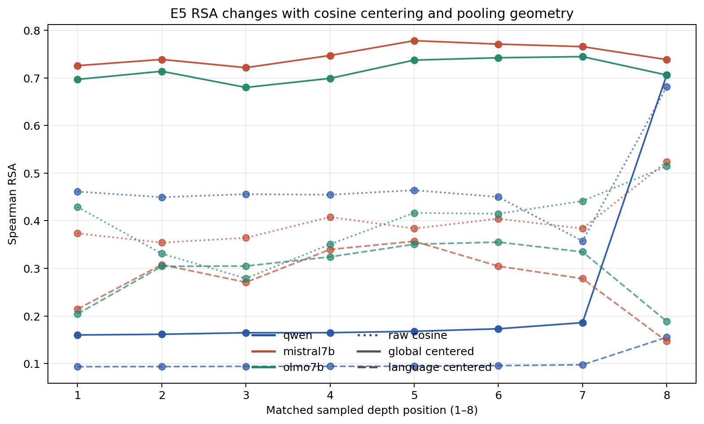
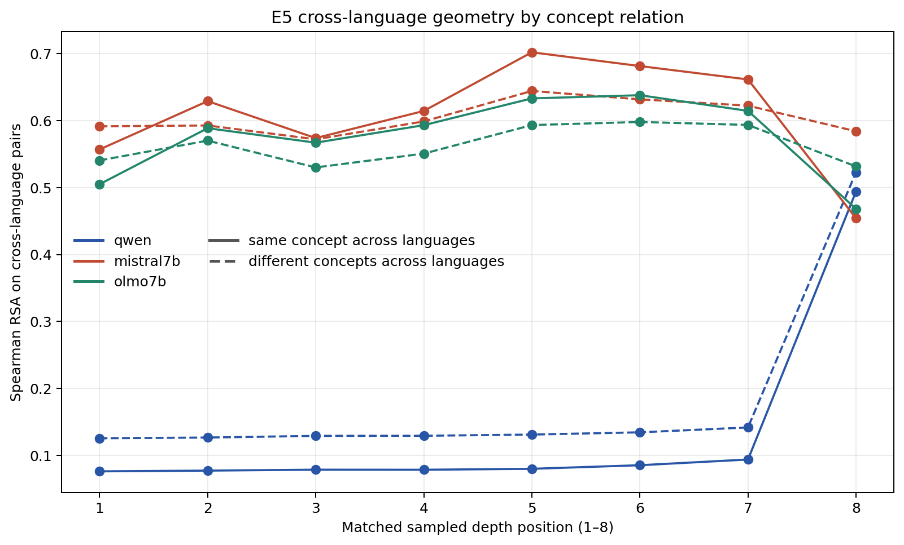
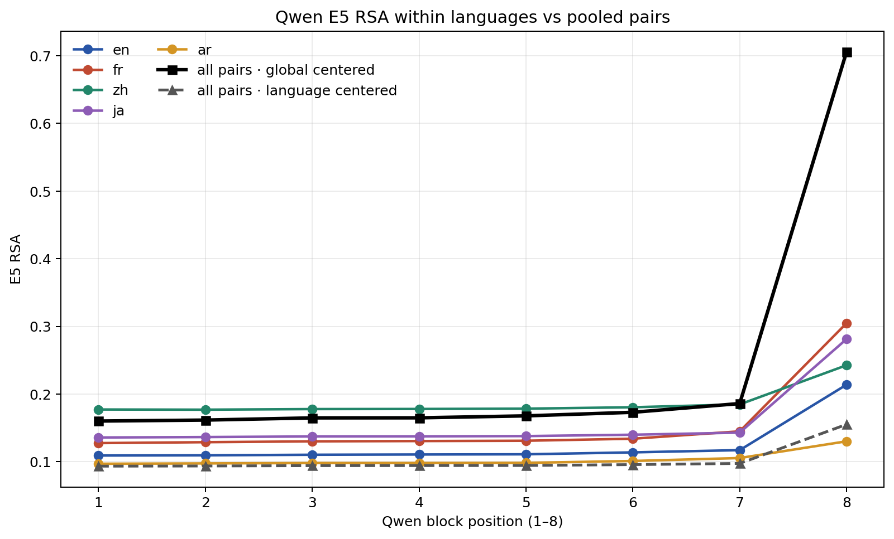
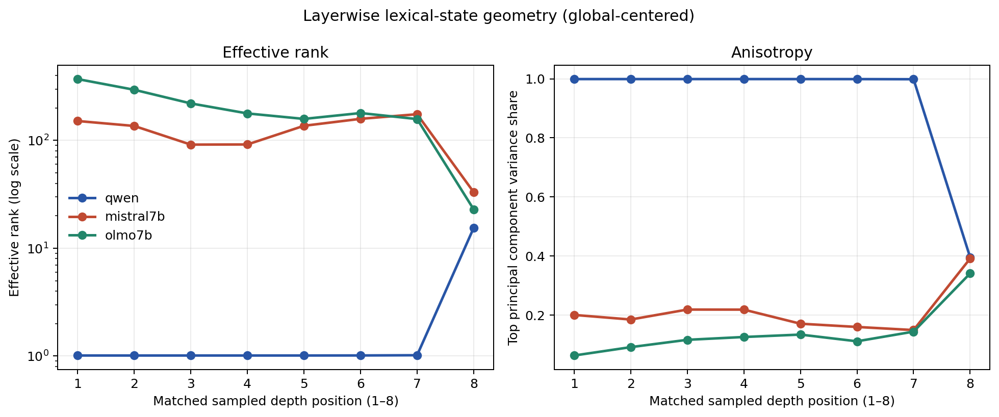

# Offline RSA diagnostic: lexical-strategy bridge

## Conclusion

Qwen's final-block E5 RSA increase is **real in the saved pooled RDM, but not robust at its original magnitude to language and geometry controls**. The original global-centered lexical-span RSA rises from 0.186 at sampled depth 7 to 0.706 at depth 8. Under language-pair, concept-match, character-length, and captured subword-count adjustment, the corresponding rank-residual RSA rises only from 0.064 to 0.123. Per-language centering reduces the transition from +0.520 to +0.058; final-token pooling reduces the global-centered transition to +0.374. Thus the large pooled spike attenuates substantially but does not disappear under every control.

The strongest explanation supported by these diagnostics is a combination of **language/script-pair structure and a sharp Qwen geometry transition**, with character-length structure also aligned to E5 at the final block. The controls are descriptive: they do not establish a cause. Mistral and OLMo show high pooled E5 RSA across depth and a small decline at their final sampled block, so Qwen's abrupt within-model endpoint change does not replicate.

This is lexical representation geometry, not evidence that pretraining created strategic representations, that a base model selected a strategy, or that any mechanism caused a behavior.

## Data, exact reproduction, and transformations

The analysis used the existing frozen inventory, local FP32 captures, and cached E5, BGE-M3, and LaBSE arrays. No model was loaded, inferred, trained, or downloaded. All 3,000 capture records passed identity, receipt, shape, finiteness, and file-hash validation. The frozen plan SHA-256 is `be762c49fd7683adafb1b616bf4bd6cdc26c91e5e2224ae967d72164e952516e`. The 1,000 isolated rows match `saved_action_analysis/reference_rows.jsonl` exactly and in order.

Before the diagnostic variants, the script recomputed the published eight-depth RSA from the lexical-span states and cached references. All values match the saved results to numerical precision: maximum absolute difference is **1.93×10⁻⁹** over 72 model × encoder × depth values. The tiny residual is floating-point reduction drift; published and recomputed values are both retained in `rsa_diagnostic_artifacts_20261106/rsa_diagnostic_results.json`.

The original transformation is: subtract the mean feature vector over all 1,000 words, L2-normalize each word vector, form cosine similarities, and Spearman-correlate upper-triangle RDM entries. The controlled variants are recorded separately:

- `raw_normalized_cosine`: no feature centering; row L2 normalization and cosine similarity.
- `global_centered_cosine`: global feature centering over all words, then row normalization and cosine similarity (the published method).
- `language_centered_cosine`: subtract each language's own feature mean, then row normalization and cosine similarity.
- Within-language RSA: subset one language, center within that language, normalize, and correlate its 19,900 word pairs.
- Cross-language classes: the globally centered geometry, separated into matching-concept translations (2,000 pairs) and distinct-concept pairs (398,000 pairs). The pooled RDM has 499,500 pairs total; only 0.4% are matching cross-language concept pairs, while 79.7% are distinct cross-language pairs.

The full JSON contains all eight depths for each model, encoder, pooling choice, transformation, language stratum, and cross-language pair class, plus the exact transformation definitions, reference-array hashes, and capture identities.

## Published E5 result and controlled final transition

| Model | Published E5, D1→D8 | Global-centered lexical Δ D7→D8 | Raw normalized Δ | Language-centered Δ | Global-centered final-token Δ | Fully adjusted rank RSA D7→D8 | Concept bootstrap Δ, 95% percentile interval |
|---|---|---:|---:|---:|---:|---:|---:|
| Qwen | .160, .162, .165, .165, .168, .173, .186, .706 | +.520 | +.324 | +.058 | +.374 | .064 → .123 (+.058) | +.516 [.489, .541] |
| Mistral | .726, .739, .722, .747, .778, .771, .766, .739 | −.027 | +.140 | −.132 | −.027 | .231 → .096 (−.135) | −.029 [−.036, −.024] |
| OLMo | .697, .714, .680, .699, .737, .742, .745, .706 | −.039 | +.073 | −.146 | −.028 | .249 → .085 (−.164) | −.041 [−.053, −.031] |

The bootstrap resamples 50 concepts with replacement within each of the four category strata, carries all five translations for each sampled concept, and recomputes the paired D7 and D8 RDM statistics. It uses 100 replicates and seed `20261106`. These percentile intervals quantify concept-sampling variation for the pooled, global-centered E5 transition; they do not correct the partial RSA, layer selection, or corpus-construction uncertainty. No pairwise RDM entries are treated as independent observations and no p-values are reported.

Qwen's final increase is not exclusive to E5: its global-centered lexical-span D7→D8 changes are +.150 for BGE-M3 and +.146 for LaBSE. However, the other two models decline at their final depth for all three encoders. The large Qwen endpoint transition is therefore not an E5-only coincidence, while the published pooled value still depends strongly on the representation geometry and language mix.



## Language/script structure and concept relationships

Language-pair adjustment subtracts mean ranks separately within each unordered language-pair stratum. The fuller adjustment additionally residualizes same-concept status, absolute and mean character-count difference, and absolute and mean model-token-count difference before correlating the residual ranks. It is a descriptive partial-rank comparison, not a causal decomposition.

| Model, E5 global-centered lexical pooling | D7 pooled RSA | D8 pooled RSA | D7 language-pair adjusted | D8 language-pair adjusted | D7 fully adjusted | D8 fully adjusted | Activation rank variance explained by language pair, D7→D8 | E5 rank variance explained by language pair |
|---|---:|---:|---:|---:|---:|---:|---:|---:|
| Qwen | .186 | .706 | .098 | .139 | .064 | .123 | .073 → .781 | .650 |
| Mistral | .766 | .739 | .256 | .107 | .231 | .096 | .810 → .865 | .650 |
| OLMo | .745 | .706 | .257 | .093 | .249 | .085 | .758 → .731 | .650 |

For Qwen, language-pair indicators account for 78.1% of the variance in final-block activation RDM ranks, and 65.0% of E5 RDM rank variance is associated with those same pair labels. This does not mean that 78.1% of RSA itself is “caused” by language; it shows that the endpoint RDM has become highly structured by language-pair membership while the reference RDM also carries strong language-pair structure.

At Qwen D7, E5 RSA is .094 for translated matching-concept pairs and .142 for distinct-concept cross-language pairs. At D8 these are .494 and .523, respectively. The endpoint increase is therefore not stronger for the translation-matched pairs. Mistral changes from .661/.622 to .454/.584 (matched/distinct); OLMo changes from .614/.593 to .468/.532. These dependent pair-class correlations are descriptive and are not compared with an independence-based significance test.



Within-language E5 RSA also rises in Qwen but remains far below the pooled .706 endpoint:

| Language | Qwen D7 → D8 | Mistral D7 → D8 | OLMo D7 → D8 |
|---|---:|---:|---:|
| English | .117 → .214 | .388 → .328 | .391 → .300 |
| French | .145 → .305 | .436 → .362 | .446 → .387 |
| Chinese | .185 → .243 | .360 → .193 | .378 → .197 |
| Japanese | .143 → .281 | .339 → .159 | .391 → .192 |
| Arabic | .105 → .130 | .341 → .303 | .317 → .229 |

The full eight-depth within-language curves for every model and encoder are in the JSON artifact.



## Length, tokenization, and pooling

Character length is Python Unicode code-point length of the frozen word string. Captured subword count is the number of tokenizer pieces whose offsets overlap the lexical span; it is model/tokenizer-specific. The E5 embedding RDM's cosine similarity has Spearman correlation **−.634** with absolute character-count differences. Qwen's global-centered lexical activation RDM changes from **−.102** at D7 to **−.616** at D8 against that same character-difference feature. In the reverse pattern, Qwen's activation-cosine correlation with absolute subword-count difference changes from **−.522** at D7 to **−.100** at D8. These are nuisance correlations, not independent tests. After controlling both character and captured subword counts together with language-pair and concept-match indicators, Qwen's E5 RSA is .123 at D8 rather than .706.

Mean captured subword counts by language further differ across model tokenizers:

| Model | EN | FR | ZH | JA | AR |
|---|---:|---:|---:|---:|---:|
| Qwen | 2.09 | 2.61 | 1.43 | 2.09 | 2.19 |
| Mistral | 1.84 | 2.49 | 3.93 | 4.37 | 5.71 |
| OLMo | 2.09 | 2.66 | 3.18 | 3.52 | 4.26 |

Final-token pooling uses the last non-special-token state already saved in each capture. It reduces Qwen's global-centered E5 D7→D8 jump from +.520 to +.374, but does not eliminate it. Mistral and OLMo remain near their lexical-span transitions. The `final` array is not a rerun or an alternative model pass.

## Geometry and decoder-block hook audit

The capture code registers forward hooks on `model.model.layers[i]` and calls `model.model` directly. The frozen sampled indices are Qwen `[3, 6, 10, 13, 17, 20, 24, 27]`; Mistral and OLMo `[3, 7, 11, 15, 19, 23, 27, 31]`. The capture image pins Transformers 5.5.4. In the corresponding local 5.5.4 model sources, each `model.model` applies `self.norm(hidden_states)` after its decoder-layer loop. The saved block states, including each final sampled block, are therefore **post-block but pre-final-model-normalization**. Source paths, line numbers, and SHA-256 hashes are in the JSON.

| Lexical pooling, sampled depth | Median activation norm | Effective rank | Top-PC variance | Rank reaching 90% | Raw cosine-distance 5th / 50th / 95th percentiles |
|---|---:|---:|---:|---:|---:|
| Qwen D7 | 5,575 | 1.018 | .999 | 1 | .00017 / .00047 / .00145 |
| Qwen D8 | 427 | 15.44 | .396 | 57 | .123 / .599 / 1.039 |
| Mistral D7 | 14.59 | 175.0 | .149 | 316 | .291 / .571 / .762 |
| Mistral D8 | 28.89 | 33.14 | .391 | 193 | .137 / .727 / 1.030 |
| OLMo D7 | 19.94 | 157.8 | .144 | 338 | .384 / .666 / .828 |
| OLMo D8 | 40.52 | 22.95 | .341 | 148 | .139 / .484 / .864 |

Qwen D1–D7 are also highly collapsed (effective rank about 1.01 throughout); D8 changes that geometry sharply. In D7, 99.85% of centered activation variance lies on the leading component and the 95th percentile raw cosine distance is only .00145. The final block has much broader angles, though it remains anisotropic. Mistral and OLMo also become more anisotropic at their final blocks, but their preceding states are not rank-one and their E5 RSA does not spike. These geometry changes are consistent with a major contributor to Qwen's discontinuity, without identifying why the block changes the representation.



## Interpretation and limits

The original observation is robust as a descriptive pooled, global-centered cosine result on these saved rows. It is **mostly attenuated by language-pair and length/token controls, and by per-language centering; it is only partly attenuated by final-token pooling or raw normalized cosine**. The Qwen final block shifts from near-constant directions and subword-count-related similarity to a broader geometry with strong character-length-related similarity. Because E5's own cosine RDM is strongly associated with character-length differences, this offers a concrete statistical account of how pooled RSA can jump. It does not establish that tokenization or character length caused the representational change.

The concept bootstrap supports that the pooled D7→D8 transition is stable to resampling this balanced 200-concept inventory, but it does not show that the same transition survives the controlled partial-RSA estimand. The partial-RSA difference is reported descriptively without a clustered interval. The embedding arrays are inherited cached outputs, though their hashes and exact row mapping were checked. The lexical translations remain provisionally reviewed; frequency, morphology, polysemy, and grapheme-aware length were not controlled. RDM pair entries are dependent, and the analysis does not treat them as independent samples.

These findings do not strengthen the original pretraining/strategic-representation hypothesis. The RSA reference models encode multilingual lexical geometry; they are not behavioral strategy labels. The Qwen endpoint difference is sensitive to language and representation geometry, so it should not be treated as evidence of a strategy-related mechanism or generalized beyond this inventory.

## Reproduction

From the repository root, using the existing local capture directories:

```powershell
python research/lexical_strategy_bridge_v1/diagnose_rsa.py `
  --capture-qwen G:\lexical_word_captures\qwen\capture `
  --capture-mistral7b G:\lexical_word_captures\mistral_fixed\capture `
  --capture-olmo7b G:\lexical_word_captures\olmo_fixed\capture `
  --output research\lexical_strategy_bridge_v1\rsa_diagnostic_reproduction_01 `
  --bootstrap-replicates 100
```

The script refuses to overwrite its output directory, validates every captured file, checks the frozen plan and reference row mapping, reproduces the legacy results first, and then writes `rsa_diagnostic_results.json`. Diagnostic tests are in `tests/test_lexical_rsa_diagnostic.py`.
