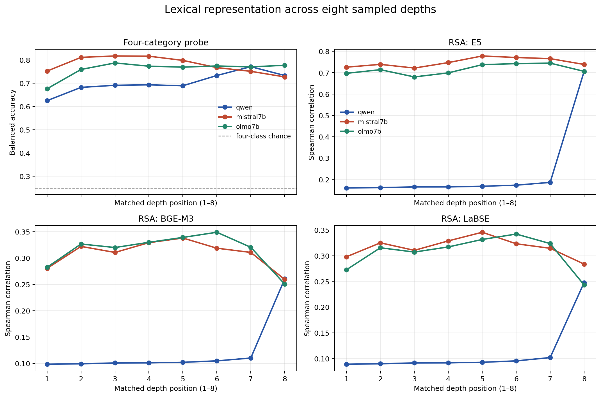

# Three-model word analysis

**Status.** Completed offline analysis of the frozen 1,000-item isolated-word captures for Qwen 2.5 1.5B, Mistral 7B v0.3, and OLMo 2 7B. All receipts say complete, non-smoke, FP32, 1,000/1,000 records, with frozen plan SHA-256 `be762c49fd7683adafb1b616bf4bd6cdc26c91e5e2224ae967d72164e952516e`. Model revisions are bound in each `capture_identity.json`. Mistral and OLMo analysis artifacts were hash-checked against the completed local analyses and captures.

## Main findings

- All three models encode lexical category information usable for concept-disjoint four-way decoding: best sampled-depth balanced accuracy is 0.771 for Qwen, 0.817 for Mistral, and 0.787 for OLMo. Per-category recall is reasonably distributed; neutral is strongest at the best depth in Qwen and OLMo.
- Cross-language transfer depends on target language and training-language mix. OLMo has the strongest English-only transfer on average; Arabic is the weakest target for each model. Transfer is not uniformly symmetric.
- Length-only controls sit modestly above four-class chance, while concept-level label-scramble controls are near chance. These controls reduce but do not eliminate lexical confounding.
- E5 RSA is high at all sampled depths in Mistral and OLMo. Qwen instead shows a sharp last-depth rise against all three embedding references. The abrupt within-Qwen spike does **not** recur in Mistral or OLMo, although their final-depth RSA values approach Qwen's. The row-to-word mapping was independently checked: all 1000 frozen isolated inventory rows match `reference_rows.jsonl` exactly and in order. A simple row-order mismatch is unlikely; the reason for Qwen's late geometry change remains unresolved.
- Projections onto historical strategy directions depend on direction type and vary across architectures, layers, and languages. They are descriptive lexical alignments, not evidence of strategy selection.

## Four-category probe accuracy across sampled depths

Each cell gives model-specific block index / concept-disjoint balanced accuracy. Positions are matched by ordinal sampling position, not identical layer count.

| Position | Qwen block / BA | Mistral block / BA | OLMo block / BA |
|---:|---:|---:|---:|
| 1 | 3 / 0.625 | 3 / 0.752 | 3 / 0.676 |
| 2 | 6 / 0.682 | 7 / 0.811 | 7 / 0.759 |
| 3 | 10 / 0.691 | 11 / 0.817 | 11 / 0.787 |
| 4 | 13 / 0.693 | 15 / 0.816 | 15 / 0.773 |
| 5 | 17 / 0.689 | 19 / 0.798 | 19 / 0.769 |
| 6 | 20 / 0.733 | 23 / 0.767 | 23 / 0.774 |
| 7 | 24 / 0.771 | 27 / 0.751 | 27 / 0.770 |
| 8 | 27 / 0.733 | 31 / 0.727 | 31 / 0.777 |

## Language transfer

Mean balanced accuracy across eight depths. `EN→target` trains only on English training concepts. `Other→target` trains on the other four languages and tests held-out concepts in the target language.

| Model | EN→FR | EN→ZH | EN→JA | EN→AR | Other→EN | Other→FR | Other→ZH | Other→JA | Other→AR |
|---|---:|---:|---:|---:|---:|---:|---:|---:|---:|
| qwen | 0.461 | 0.556 | 0.486 | 0.384 | 0.661 | 0.567 | 0.782 | 0.719 | 0.503 |
| mistral7b | 0.691 | 0.443 | 0.406 | 0.277 | 0.884 | 0.792 | 0.836 | 0.768 | 0.472 |
| olmo7b | 0.768 | 0.793 | 0.698 | 0.461 | 0.860 | 0.777 | 0.834 | 0.761 | 0.489 |

## Controls, uncertainty, and category recall

Chance balanced accuracy is 0.25. Length-only uses character length and tokenizer token count. The concept-label permutation is one concept-level training-label scramble per fold; it is a diagnostic, not a calibrated permutation test. Bootstrap intervals resample held-out concepts conditional on fitted folds. The best-depth intervals below do not adjust for selecting that depth.

**Best-depth performance and per-category recall**

| Model | Best position (block) | Balanced accuracy [concept-bootstrap 95%] | Coop. | Comp. | Indep. | Neutral |
|---|---:|---:|---:|---:|---:|---:|
| qwen | 7 (24) | 0.771 [0.739, 0.803] | 0.724 | 0.760 | 0.748 | 0.852 |
| mistral7b | 3 (11) | 0.817 [0.785, 0.845] | 0.804 | 0.832 | 0.800 | 0.832 |
| olmo7b | 3 (11) | 0.787 [0.755, 0.817] | 0.784 | 0.800 | 0.736 | 0.828 |

**Controls across the eight depths**

| Model | Length-only mean [range] | Permuted-label mean [range] |
|---|---:|---:|
| qwen | 0.321 [0.321, 0.321] | 0.243 [0.230, 0.254] |
| mistral7b | 0.293 [0.293, 0.293] | 0.244 [0.224, 0.275] |
| olmo7b | 0.309 [0.309, 0.309] | 0.222 [0.192, 0.260] |

These intervals omit translation and corpus-construction uncertainty. Point estimates support decodability for this inventory; they do not establish category separability for unrestricted vocabulary.

## RSA correspondence with multilingual embedding references

Each value is Spearman correlation between upper-triangle, within-representation centered-cosine similarity matrices. Hidden vectors from different architectures are never compared directly. These are descriptive RSA estimates; pairwise entries are dependent.

**E5**

| Model (e5) | D1 | D2 | D3 | D4 | D5 | D6 | D7 | D8 | Final − mean(D1–D7) |
|---|---:|---:|---:|---:|---:|---:|---:|---:|---:|
| qwen | 0.160 | 0.162 | 0.165 | 0.165 | 0.168 | 0.173 | 0.186 | 0.706 | +0.538 |
| mistral7b | 0.726 | 0.739 | 0.722 | 0.747 | 0.778 | 0.771 | 0.766 | 0.739 | -0.011 |
| olmo7b | 0.697 | 0.714 | 0.680 | 0.699 | 0.737 | 0.742 | 0.745 | 0.706 | -0.010 |

**BGE-M3**

| Model (bge-m3) | D1 | D2 | D3 | D4 | D5 | D6 | D7 | D8 | Final − mean(D1–D7) |
|---|---:|---:|---:|---:|---:|---:|---:|---:|---:|
| qwen | 0.098 | 0.099 | 0.101 | 0.101 | 0.102 | 0.105 | 0.110 | 0.260 | +0.158 |
| mistral7b | 0.280 | 0.322 | 0.310 | 0.329 | 0.338 | 0.319 | 0.311 | 0.259 | -0.056 |
| olmo7b | 0.282 | 0.326 | 0.320 | 0.330 | 0.339 | 0.349 | 0.320 | 0.250 | -0.073 |

**LaBSE**

| Model (labse) | D1 | D2 | D3 | D4 | D5 | D6 | D7 | D8 | Final − mean(D1–D7) |
|---|---:|---:|---:|---:|---:|---:|---:|---:|---:|
| qwen | 0.089 | 0.090 | 0.091 | 0.091 | 0.093 | 0.095 | 0.102 | 0.248 | +0.155 |
| mistral7b | 0.298 | 0.325 | 0.311 | 0.329 | 0.346 | 0.323 | 0.315 | 0.284 | -0.037 |
| olmo7b | 0.273 | 0.316 | 0.307 | 0.317 | 0.332 | 0.342 | 0.324 | 0.243 | -0.073 |

The archived embedding audit records file hashes and a matching source-lexicon byte hash. The exact frozen isolated row order also matches the reference-row manifest (PASS). This addresses the largest obvious alignment artifact but does not independently reproduce embedding-model inference. Qwen's last-depth rise is large (E5 +0.538 vs its first-seven-depth mean); the corresponding changes are small or negative for Mistral and OLMo. The abrupt spike is therefore Qwen-specific in this sample, not an architecture-general replicated pattern.

## Historical strategy-direction projections

Historical class-mean directions were saved from the original analysis. Original fitted logistic coefficients were not serialized; the second direction family uses reconstructed coefficients accepted only after every historical held-out prediction matched. Matching predictions do not prove bit-identical original coefficients. Each projection subtracts the lexical mean of each language, so it is a within-language lexical contrast and omits intercepts. Neutral remains a lexical category and is never relabeled `DISENGAGE`.

The table counts which lexical category has the largest mean projection, out of 64 projections per model and direction source (8 depths × 2 historical splits × 4 strategy axes). These descriptive counts are not model preferences.

| Model | Direction source | Cooperation | Competition | Independent | Neutral |
|---|---|---:|---:|---:|---:|
| qwen | Saved class-mean | 2 | 0 | 32 | 30 |
| qwen | Refitted logistic | 1 | 2 | 36 | 25 |
| mistral7b | Saved class-mean | 11 | 26 | 13 | 14 |
| mistral7b | Refitted logistic | 13 | 24 | 15 | 12 |
| olmo7b | Saved class-mean | 11 | 23 | 12 | 18 |
| olmo7b | Refitted logistic | 14 | 18 | 14 | 18 |

Across matched depths and direction keys, median cross-architecture Spearman correlation of four-category profiles is 0.20; the same winning category occurs in 131/384 architecture pairs (34.1%). For language-specific profiles, median cross-architecture Spearman is 0.00, with winner agreement in 568/1920 pairs (29.6%). This limited concordance does not support a stable category-specific alignment shared across architectures and languages. Some direction winners persist across layers within a model, but those repeated comparisons are descriptive.

## Limits and interpretation

- The inventory contains 200 concepts × five translations and remains linguistically provisional; fluent-speaker review is pending. Concepts, not translations, were held out across five stratified folds.
- The length control covers character length and tokenizer count only. Frequency, morphology, polysemy, valence, and translation artifacts remain unmeasured.
- Bootstrap intervals condition on fitted folds. Layer selection and the single concept-label scramble are not inferentially calibrated.
- RSA is descriptive, with dependent pairwise observations and inherited embedding provenance. Row mapping was verified, but embedding inference was not rerun.
- Historical directions come from a distinct task and preprocessing frame. The projections are not calibrated historical probe scores and do not establish cross-context transfer.
- These findings concern decodability and representation geometry only. They establish no novelty, behavioral strategy selection, preference, or causal mechanism.

## Reproduction and artifacts

`analyze_words.py` was run on saved FP32 records only; no GPU inference was rerun, and no capture or corpus was modified. Results, directions, receipts, and capture identities are under `word_analysis_results/{qwen,mistral7b,olmo7b}/`. The figure is `three_model_depth_comparison.png`. Relevant tests: `tests/test_lexical_strategy_bridge.py` and `tests/test_wordlevel_bridge.py` (7 passed; pytest plugin autoload was disabled to work around a local SSL key-log permission error).
