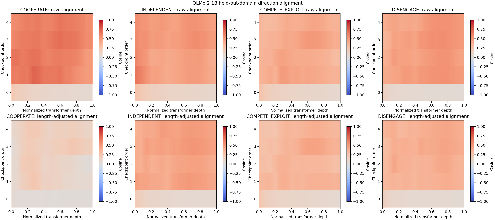
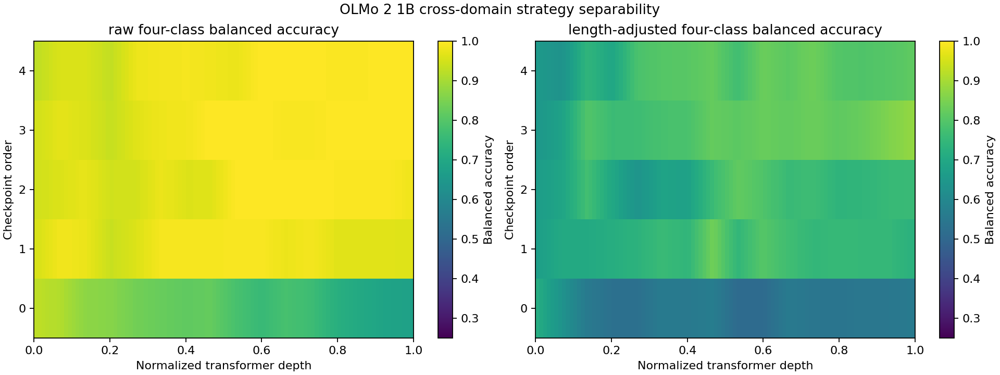

# OLMo 2 1B pretraining-emergence trajectory

## Earliest sampled checkpoint meeting the criterion

| Strategy | Checkpoint order | Revision | Stage | Cumulative tokens (B) | Normalized depth |
|---|---:|---|---|---:|---:|
| COOPERATE | 0 | `stage1-step0-tokens0B` | initialization | 0 | 0.000 |
| INDEPENDENT | 0 | `stage1-step0-tokens0B` | initialization | 0 | 0.000 |
| COMPETE_EXPLOIT | 0 | `stage1-step0-tokens0B` | initialization | 0 | 0.000 |
| DISENGAGE | 0 | `stage1-step0-tokens0B` | initialization | 0 | 0.000 |

## Criterion

For each strategy and layer, both the lexical-adjusted held-out-domain direction-alignment and projection-margin cluster bootstrap lower bounds exceed zero; Bonferroni controls familywise error across all sampled checkpoint x layer x strategy tests. Earliest sampled checkpoint satisfying the rule is reported; no exact emergence time is inferred.

Raw and length-adjusted trajectory values are included separately in the JSON. Layer depth is normalized within each model checkpoint. These five samples do not identify an exact emergence time.

This study measures strategy-related information in residual streams. It does not show that those representations cause cooperative decisions or establish a cooperative preference.
