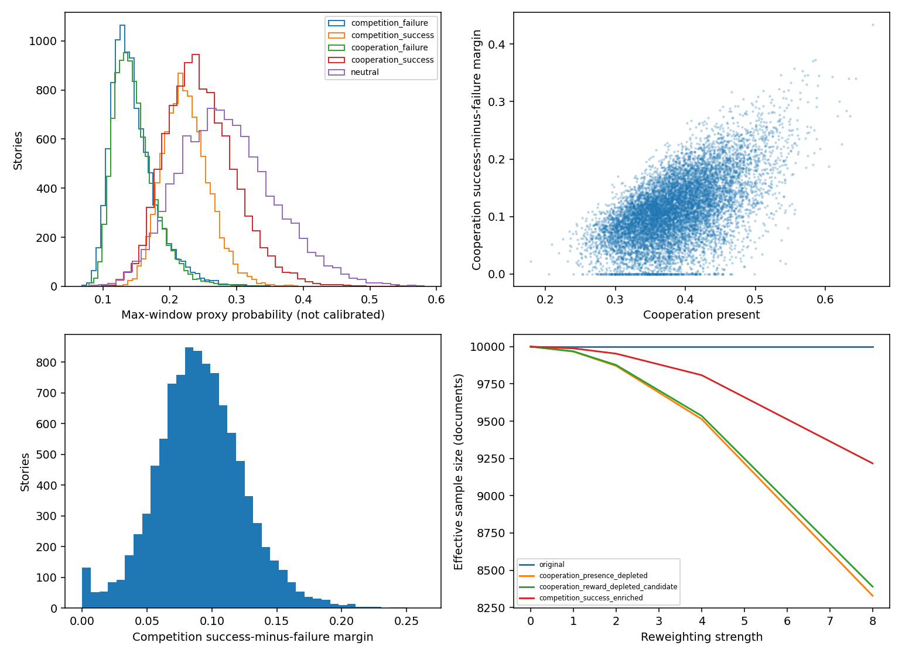
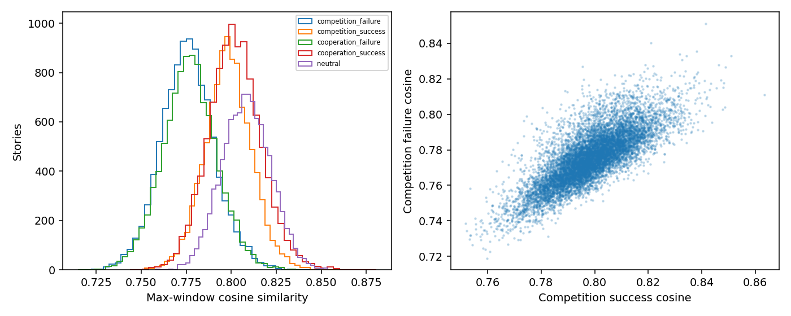

# TinyStories semantic-classifier empirical pilot

**Recommendation: revise and independently validate the semantic classifier before a full embedding census or training-distribution freeze.**

The released stories contain successful cooperation, unsuccessful cooperation, fair competitive victories, unpunished selfish acquisition, and neutral/individual narratives. This establishes existence, not a validated intervention. The existing E5 score is an uncalibrated similarity proxy; success, moral approval, actor identity and mere behavior presence must be distinguished. All semantic review judgments below are provisional Codex-assisted readings, not human gold labels.

The main empirical result is **11/20 strict successes** at the top of the competition ranking, versus **18/20** after including independent achievement. Top-20 subtypes: 11 fair/performance successes and 0 confirmed selfish appropriation/exploitation successes. At strength 8 the competition proxy rises from 0.093 to 0.102, while the cooperative-reward proxy also rises from 0.115 to 0.125. These sample projections do not establish the intended social-valence intervention.

## Execution and sampling

Pinned train source: `roneneldan/TinyStories@f54c09fd23315a6f9c86f9dc80f725de7d8f9c64`. Tokenizer: `openai-community/gpt2@607a30d783dfa663caf39e06633721c8d4cfcd7e`. E5: `d13f1b27baf31030b7fd040960d60d909913633f`; normalized vectors, `query: ` preprocessing, fixed original anchors, temperature .05, 192-token windows/128 stride.

Parquet metadata: **2,119,719 train rows**. Uniform without-replacement sample: **10,000 rows**, seed 20261107; source quartiles contain 2,590 / 2,499 / 2,476 / 2,435 samples. The 500-story smoke is nested and random, not a prefix. All source indices, hashes, shard rows and five separate window similarities/proxies are preserved.

Local CPU smoke: 881 windows, 207.9s (2.41 stories/s). Remaining sample: 9,500 new stories, 17,039 windows, 3774.0s. No Modal, Lambda resources, external model API, LM training, full-corpus embedding run or HF publication. Cloud charges: **$0**. Source shards (~991MB) were read to retrieve the random sample and remain ignored, together with full stories and caches.

## Integrity review and classification

Review: 140 unique stories = independent random40, then disjoint high/low cooperation20+20, high/low competitive-success20+20, ambiguous20. Codex read full stories; score strata were known but numerical scores were not shown during reading. Exact evidence offsets are verified against source text. Deterministic candidate extraction does not validate meaning. No independent annotator or inter-rater agreement exists. Eight additional purposive lexical follow-ups and one early score-tail false-positive case are excluded from prevalence and classifier metrics.

Top-20 competitive-success retrieval precision against provisional strict rivalrous/selfish success labels: **11/20 (55.0%; 95% Wilson 34.2%–74.2%)**. Including separate independent personal successes: 18/20 (90.0%; 95% Wilson 69.9%–97.2%). Uncertain interpretations among the 140: **31**. The first precision includes all selected cases conservatively; uncertainty exclusions are used only for the diagnostic confusion matrices.

Frozen diagnostic thresholds: cooperation presence ≥.5; cooperative-reward margin ≥.25; competitive-success margin ≥.1. These thresholds were not optimized on the labels. Review-stratified accuracy is not population accuracy. Intervals condition on fallible provisional labels and do not account for annotation bias.

The top20 Wilson interval is a descriptive binomial summary, not a guarantee about whole-corpus precision. Prevalence points retain tentative labels; additional_diagnostics.json includes sensitivity bounds that recode all uncertain random cases. Annotation rules were clarified during this exploratory pilot for consistency, including counting explicit thanks/praise to a helper as social return. These are development-set metrics, not independent human validation.

| Diagnostic / review scope | TP | FP | FN | TN | Precision | Recall | Uncertain excluded |
|---|---:|---:|---:|---:|---|---|---:|
| cooperation_present:random40 | 0 | 0 | 22 | 10 | not estimable | 0/22 (0.0%; 95% Wilson 0.0%–14.9%) | 8 |
| cooperation_present:stratified140 | 19 | 0 | 46 | 44 | 19/19 (100.0%; 95% Wilson 83.2%–100.0%) | 19/65 (29.2%; 95% Wilson 19.6%–41.2%) | 31 |
| cooperation_rewarded:random40 | 0 | 1 | 17 | 14 | 0/1 (0.0%; 95% Wilson 0.0%–79.3%) | 0/17 (0.0%; 95% Wilson 0.0%–18.4%) | 8 |
| cooperation_rewarded:stratified140 | 15 | 1 | 33 | 60 | 15/16 (93.8%; 95% Wilson 71.7%–98.9%) | 15/48 (31.2%; 95% Wilson 19.9%–45.3%) | 31 |
| competition_rewarded:random40 | 0 | 16 | 1 | 15 | 0/16 (0.0%; 95% Wilson 0.0%–19.4%) | 0/1 (0.0%; 95% Wilson 0.0%–79.3%) | 8 |
| competition_rewarded:stratified140 | 11 | 43 | 1 | 54 | 11/54 (20.4%; 95% Wilson 11.8%–32.9%) | 11/12 (91.7%; 95% Wilson 64.6%–98.5%) | 31 |

Threshold-free ranking diagnostics (uncertain cases excluded):

| Target / scope | AUROC | Positive / negative cases |
|---|---:|---:|
| cooperation_present:random40 | 0.659 | 22 / 10 |
| cooperation_present:stratified140 | 0.806 | 65 / 44 |
| cooperation_rewarded:random40 | 0.671 | 17 / 15 |
| cooperation_rewarded:stratified140 | 0.803 | 48 / 61 |
| competition_rewarded:random40 | 0.000 | 1 / 31 |
| competition_rewarded:stratified140 | 0.910 | 12 / 97 |

Do not infer ranking failure solely from arbitrary-threshold recall. Conversely, high accuracy on score-targeted extremes is not population validation. Random40 rare-class AUROC can depend on just one positive.

Among the high-competition20 reviews: **11** fair/performance successes, **0** selfish appropriation/exploitation successes, and **9** cases without an established competitive success. The subtype distinction matters for what an enriched corpus would actually teach.

Approximate prevalence from **random40 only** (labels can overlap; neutral can include independent success):

| Reviewed category | Random40 estimate |
|---|---|
| cooperation_present | 27/40 (67.5%; 95% Wilson 52.0%–79.9%) |
| cooperation_rewarded | 21/40 (52.5%; 95% Wilson 37.5%–67.1%) |
| cooperation_punished | 1/40 (2.5%; 95% Wilson 0.4%–12.9%) |
| competition_present | 7/40 (17.5%; 95% Wilson 8.7%–31.9%) |
| competition_rewarded | 1/40 (2.5%; 95% Wilson 0.4%–12.9%) |
| competition_punished | 4/40 (10.0%; 95% Wilson 4.0%–23.1%) |
| independent_success | 7/40 (17.5%; 95% Wilson 8.7%–31.9%) |
| neutral | 11/40 (27.5%; 95% Wilson 16.1%–42.8%) |

The `cooperation_punished` field means unsuccessful/adverse cooperation, not moral punishment and not proof cooperation caused harm. Actor reward requires the actor/group's stated goal, mutual benefit, or explicit emotional/social return; help to a recipient alone is not automatically rewarded cooperation. Competition success means achieving a rivalrous/selfish aim, even if morally condemned. Independent achievement is a separate label. Fair competitive achievement and antisocial success must not be silently pooled.

Illustrative random-review cases show why presence and reward must remain separate. Weights below are **unnormalized**, at strength 4, and do not certify the reward proxy:

| Source / provisional interpretation | Cooperation presence | Cooperative-reward margin | Competitive-success margin | Presence-depleted weight | Reward-depleted candidate weight |
|---|---:|---:|---:|---:|---:|
| 889736 / cooperation_present, cooperation_rewarded | 0.449 | 0.208 | 0.102 | 0.166 | 0.435 |
| 1009718 / cooperation_present, cooperation_punished, competition_present | 0.375 | 0.059 | 0.100 | 0.223 | 0.790 |
| 1120463 / competition_present, competition_rewarded | 0.383 | 0.000 | 0.009 | 0.216 | 1.000 |
| 614803 / cooperation_present | 0.282 | 0.041 | 0.041 | 0.324 | 0.850 |
| 1012827 / neutral, independent_success | 0.449 | 0.285 | 0.141 | 0.166 | 0.320 |

## Score distributions and reweighting projections

Max-window proxy values are not probabilities of narrative classes, and maxima across windows need not sum to one. See `pilot_metrics.json` for quantiles and all five argmax-cosine proxy counts; those counts are not reviewed prevalence.

| Sample weighting candidate | Strength | Document ESS | Max weight / mean | Token-weighted cooperation presence | Cooperative-reward margin | Competitive-success margin |
|---|---:|---:|---:|---:|---:|---:|
| original | 0 | 10000 | 1.00 | 0.393 | 0.115 | 0.093 |
| cooperation_presence_depleted | 0 | 10000 | 1.00 | 0.393 | 0.115 | 0.093 |
| cooperation_presence_depleted | 1 | 9967 | 1.23 | 0.390 | 0.114 | 0.093 |
| cooperation_presence_depleted | 2 | 9870 | 1.50 | 0.386 | 0.112 | 0.092 |
| cooperation_presence_depleted | 4 | 9514 | 2.22 | 0.380 | 0.108 | 0.092 |
| cooperation_presence_depleted | 8 | 8329 | 4.71 | 0.368 | 0.102 | 0.090 |
| cooperation_reward_depleted_candidate | 0 | 10000 | 1.00 | 0.393 | 0.115 | 0.093 |
| cooperation_reward_depleted_candidate | 1 | 9968 | 1.12 | 0.391 | 0.112 | 0.092 |
| cooperation_reward_depleted_candidate | 2 | 9877 | 1.24 | 0.390 | 0.109 | 0.091 |
| cooperation_reward_depleted_candidate | 4 | 9536 | 1.53 | 0.386 | 0.103 | 0.088 |
| cooperation_reward_depleted_candidate | 8 | 8390 | 2.22 | 0.381 | 0.092 | 0.083 |
| competition_success_enriched | 0 | 10000 | 1.00 | 0.393 | 0.115 | 0.093 |
| competition_success_enriched | 1 | 9988 | 1.19 | 0.393 | 0.117 | 0.094 |
| competition_success_enriched | 2 | 9953 | 1.41 | 0.394 | 0.118 | 0.095 |
| competition_success_enriched | 4 | 9809 | 1.98 | 0.394 | 0.120 | 0.098 |
| competition_success_enriched | 8 | 9217 | 3.84 | 0.396 | 0.125 | 0.102 |

All weights retain full support. Shifts above concern proxies on the random sample, not validated class composition or causal outcome prevalence. The reward-depleted candidate is exploratory and is not a selected replacement intervention. Increasing proxy score can enrich classification errors; enrichment creates repetition rather than new unique evidence.

Across-story correlations between max success and failure cosines: cooperation **0.580**, competition **0.775**. These are descriptive overlap diagnostics, not proof of mechanism or validity. Additional_diagnostics.json contains uncertainty sensitivity bounds and length/window-count correlations.

## Token supply: observations versus estimates

Observed 10k sample: **2,241,426 tokens including EOS**, 9,994 exact-unique texts and **2,240,520 exact-unique-text tokens**. The empirical source-token projection is **475,119,328**, with approximate normal 95% interval 470,619,416–479,619,240; this is an estimated total token count, **not** a full census or unique-token count.

Full-corpus unique tokens and usable class-specific supply remain **UNKNOWN**. Sample deduplication cannot identify unseen duplicate clusters. The reviewed-supported exact-unique token lower bounds within this sample (excluding uncertain cases) are:

| Reviewed class | Observed sample-supported tokens |
|---|---:|
| cooperation_rewarded | 12,135 |
| competition_rewarded | 2,594 |
| independent_success | 3,634 |
| neutral | 5,295 |
| competitive subtype: FAIR_OR_PERFORMANCE_CONTEST | 2,415 |
| competitive subtype: SELFISH_APPROPRIATION_OR_EXPLOITATION | 179 |

Random40 token-mass point estimates are recorded in pilot_metrics.json. They are highly uncertain and cannot certify a supply of competition-favouring training tokens. Scaling the score-enriched review set to the corpus would be invalid. No extrapolated unique-token supply is asserted.

## Twenty-five representative excerpts

Excerpts are short evidence pointers, not complete stories. Full actor/action/outcome interpretations and uncertainty are in integrity_reviews.json. Source indices refer to the pinned train split; quote offsets and text hashes permit retrieval. Cases were selected for coverage/errors, not frequency.

| Source index / selection | Provisional interpretation | Evidence excerpt |
|---|---|---|
| 889736 / independent_random | cooperation_present, cooperation_rewarded | We built a house for our dolls. |
| 1009718 / independent_random | cooperation_present, cooperation_punished, competition_present | Everyone in the kingdom united to fight the dragon |
| 1120463 / independent_random | competition_present, competition_rewarded | friend never returned the cartoon. |
| 1902386 / independent_random | neutral, independent_success | he was now small enough to fit. |
| 27314 / high_cooperation | cooperation_present, cooperation_rewarded | So the little boy and his mom had a lot of fun playing with the hose. |
| 119549 / high_cooperation | cooperation_present, cooperation_rewarded | instead chose to work together towards the same goal. |
| 132141 / high_cooperation | cooperation_present, cooperation_rewarded, competition_present, competition_punished | They work together to fix the network. |
| 275865 / high_cooperation | cooperation_present, cooperation_rewarded, competition_present | they had found a way to both have what they wanted. |
| 201034 / low_cooperation | cooperation_present, cooperation_rewarded | The girl was so happy and excited! |
| 308108 / low_cooperation | neutral, independent_success | The bird felt happy and continued to enjoy the view. |
| 345767 / low_cooperation | independent_success; UNCERTAIN | The dog stopped barking and walked away. |
| 548553 / high_successful_competition | cooperation_present, competition_present, competition_punished | no matter what the girl was still there. |
| 1801817 / high_successful_competition | competition_present, competition_rewarded | He got the big, shiny trophy and everyone cheered. |
| 1222083 / high_successful_competition | neutral, independent_success | He knew that it had been a successful day |
| 30491 / high_successful_competition | cooperation_present, cooperation_rewarded, competition_present, competition_rewarded | The final score was five to one! |
| 181709 / high_successful_competition | cooperation_present, independent_success | he was able to successfully complete the routine. |
| 20501 / low_successful_competition | neutral | His excitement had been replaced with frustration. |
| 55339 / low_successful_competition | neutral; UNCERTAIN | They were very sad that they lost their dad in the fire. |
| 47303 / ambiguous | competition_present, competition_punished; UNCERTAIN | She wished she hadn't been so stubborn. |
| 113775 / ambiguous | cooperation_present, cooperation_rewarded | So they played kick the ball and they were best friends ever since. |
| 27587 / purposive follow-up (score rank 2790) | competition_rewarded | At the end of the race, the bird won. |
| 58249 / purposive follow-up (score rank 281) | competition_rewarded | Maggie won the race and everyone cheered. |
| 54716 / purposive follow-up (score rank 2322) | competition_punished | They learned that sharing and playing together is more fun than competing and fighting. |
| 1549810 / purposive follow-up (score rank 23) | cooperation_rewarded | When you are generous, you will be rewarded with kindness. |
| 60001 / purposive follow-up (score rank 9055) | ambiguous | Molly and Jenny decided that, in the end, the cat had won the race. |

## Decision and limitations

Proceed with **classifier revision and a further held-out validation sample**, not a full embedding census yet. Keep the original anchors as a baseline. Separate cooperative presence from successful cooperative outcomes; distinguish fair contests, exploitation/selfish appropriation and independent achievement; extract the same actor's action and terminal outcome. Include counterfactual helping, repentance, actor swaps, negation and success-before-later-punishment as challenge cases. Keep moral endorsement separate from instrumental gain.

The evidence establishes that candidate narratives exist; the original semantic filter has not established reliable retrieval or usable token supply. Review a blinded, independently human-annotated set with explicit actor/outcome rules before choosing an intervention. Use a held-out portion to set acceptance criteria and thresholds; do not tune and claim validation on these same 140 examples. A later full census should report reviewed precision at selected strengths, independent-success and fair-contest composition, deduplicated token support, topic/length shifts and repetition. Neither full-corpus embeddings nor training is authorized by this report.

TinyStories is a synthetic released corpus, not naturally occurring human-authored text. Conclusions concern existing narratives in this corpus. Short story windows can miss the ending; max pooling can select early success despite later punishment; the five anchor groups are narrow and their softmax imposes relative competition between classes. Caregiving versus strategic cooperation is a coding boundary. A single provisional model-assisted reviewer, 40 random judgments and targeted extreme-score sampling cannot establish human-level classifier validity or narrow rare-class prevalence.

Deterministic source-integrity flags in the 10k sample: 0 stories contain Unicode replacement characters, 1 repeat an identical paragraph at least four times, and 115 end without terminal punctuation. These are diagnostic flags, not exclusions or proof of invalid stories. Their reweighted fractions are preserved in quality_diagnostics.json. Equal-score review ties use source order, so the zero-score stratum is not a randomized prevalence sample within that bin.

## Reproduction and artifacts

See ../pilot_tools/README.md. `sample_manifest.json` pins source/tokenizer/encoder and shard hashes; `sample_index.jsonl` preserves source IDs/content hashes; `scores.jsonl.gz` preserves all per-window scores; `review_selection.json`, `review_notes.json`, `integrity_reviews.json` and `supplementary_cases.json` preserve review provenance; `pilot_metrics.json` contains counts, intervals and projections; `artifact_manifest.json` authenticates the compact package. Source text/shards and large caches are excluded from Git. Actual installed versions are in scorer_identity.json. Report commands do not train models or publish data.

Sources: [pinned TinyStories](https://huggingface.co/datasets/roneneldan/TinyStories/tree/f54c09fd23315a6f9c86f9dc80f725de7d8f9c64), [TinyStories paper](https://arxiv.org/abs/2305.07759), existing lexical encoder audits in this repository.
